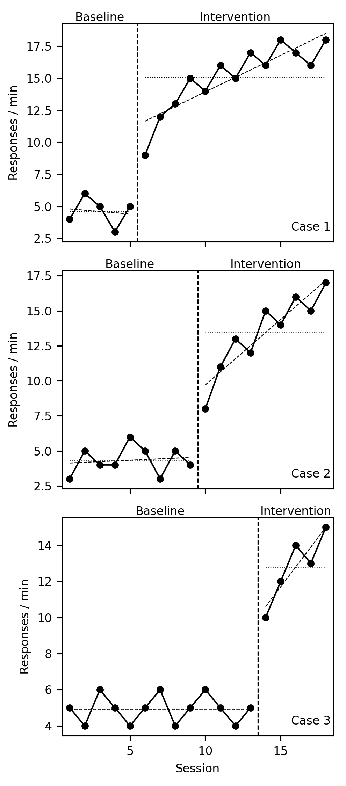

# session-analyzer

:gb: [English README](README.md)

OperantKit セッションログのための累積記録可視化、統計分析、行動モデル・フィッティング。

OKL v1 セッションログ（通常は `session-recorder` が生成）を読み込み、以下を生成する:

- 強化 tick マーク付きの累積反応記録
- DRL / DRO 可視化のための IRT 色分け累積記録
- バウト分解された反応率指標 (Shull, Gaynor, & Grimes, 2001)
- 一般化マッチング法則 (GML) のパラメータ・フィット (Baum, 1974)
- 単一選択双曲フィット (Herrnstein, 1970)
- 並立スケジュールにおける選択配分分析
- 反応潜時の要約統計量
- Progressive Ratio ブレイクポイント検出 (Richardson & Roberts, 1996)。ブレイクポイントは最後に完了した比率。MED-PC のプログラムによっては進行中の比率をブレイクポイント変数に入れるので、その値とは 1 段ずれる。`extract_step_ratios(..., timeout_sec=...)` は強化後タイムアウト中の反応を数えない。
- 遅延割引モデルのフィット (Mazur, 1987; Rachlin, 2006)
- 指数型需要曲線フィットと P_max / O_max (Hursh & Silberberg, 2008)
- 行動慣性・変化への抵抗の推定 (Nevin, 1992)
- Peak procedure 分析 — ビン平滑化と 3 状態 MLE (Roberts, 1981; Church, Meck, & Gibbon, 1994)
- 刺激般化勾配 — ガウス型と指数型 (Guttman & Kalish, 1956; Shepard, 1987)
- 強化後ポーズ (PRP) 要約と quarter-life 指標 (Felton & Lyon, 1966; Herrnstein & Morse, 1957)
- FR ラン長分解 (Schlinger, Derenne, & Baron, 2008)
- Kaplan-Meier 生存曲線・消去曲線 (Kaplan & Meier, 1958)
- 並立連鎖スケジュールの双曲減衰予測 (Mazur, 2001)
- パヴロフ型条件づけ接近の tracking index (Flagel et al., 2007; Meyer et al., 2012)
- オペラント変動性 U-value (Page & Neuringer, 1985) と Lag-N pass rate (Neuringer, 2002)
- Log-survivor IRT 分析と bilinear バウトフィット (Shull, 1991)
- 信号検出理論 (d', c, β, A', B'') と ROC / AUC (Green & Swets, 1966; Hautus, 1995)
- Resurgence (3 相手続き; Shahan & Sweeney, 2011)
- Renewal 分類 (ABA / ABC / AAB; Bouton, 2004)
- 時間配分マッチング (Baum & Rachlin, 1969)
- セッション内応答率ダイナミクス (McSweeney, Roll, & Cannon, 1994)
- Discrimination ratio と peak shift (Hanson, 1959; Annau & Kamin, 1961)
- Adjusting 無差異点 (Mazur, 1987)
- Unit-price と cross-price 弾力性 (Hursh, 1980; Hursh & Roma, 2013)
- 観察反応と条件性強化子の強度 (Wyckoff, 1952; Dinsmoor, 1983)
- Rescorla-Wagner 連合強度シミュレーション・フィッティング (Rescorla & Wagner, 1972)
- 表形式 TD(0) 強化学習トレース (Sutton, 1988; Schultz, Dayan, & Montague, 1997)
- スカラー時間要約とスカラー特性検定 (Gibbon, 1977)
- Killeen の定量的効果の法則 / MPR (Killeen, 1994)
- 並立スケジュールの stay-switch 分解と COD 遵守率 (Stubbs & Pliskoff, 1969)
- 消去バースト検出 (Lerman & Iwata, 1995)
- Schneider の 2 状態 break-and-run セグメンテーション (Schneider, 1969)
- 心理測定関数フィッティング（logit / probit; Wichmann & Hill, 2001）
- EZ 拡散モデルパラメータ復元 (Wagenmakers, van der Maas, & Grasman, 2007)
- IRT 自己相関とピリオドグラム・スペクトル
- N-gram ブロック / 条件付き entropy と Markov 次数推定 (Hopson, Burt, & Hopson, 2002)
- 多財クロス価格弾力性行列
- 階層経験ベイズ Generalized Matching Law フィット (Gelman & Hill, 2007)
- ガウス Hidden Markov Model セグメンテーション (Rabiner, 1989)

## インストール

```bash
pip install session-analyzer
```

開発用:

```
mise install                                # Python 3.11
mise exec -- python -m venv .venv
.venv/bin/python -m pip install -e ".[dev]"
.venv/bin/pytest
```

## 30 秒で動く例

[session-recorder](https://github.com/OperantKit/session-recorder) で短い FR 5 のセッションを書き、読み戻し、強化後休止を測り、累積記録を描き、一般化対応法則を当てはめる:

```python
import math
from pathlib import Path

from experiment_core import ReinforcerStartEvent, ResponseEvent
from session_recorder import OklSink, iter_records
from session_analyzer import plot_cumulative_record
from session_analyzer.analytics import analyze_prps, compute_prps, estimate_matching_parameters

# 短い FR 5 の記録: 休止、0.5 秒間隔の 5 反応、強化子。
sink = OklSink("fr5.okl")
sink.write_header(session_name="fr5", clock_type="VirtualClock", session_start=0.0)
t, n = 0.0, 0
for pause in (4.0, 6.0, 8.0):
    t += pause
    for k in range(5):
        t += 0.5 if k else 0.0
        n += 1
        sink.emit(ResponseEvent(id=n, timestamp=t))
    sink.emit(ReinforcerStartEvent(id=n // 5, timestamp=t))

records = list(iter_records("fr5.okl"))
responses = [r.timestamp for r in records if r.type == "response"]
reinforcers = [r.timestamp for r in records if r.type == "reinforcer_start"]
print(compute_prps(reinforcers, responses))  # [6.0, 8.0]  強化後休止
print(analyze_prps(compute_prps(reinforcers, responses)).mean)  # 7.0

plot_cumulative_record(Path("fr5.okl"), Path("fr5.png"))  # 強化子の印つきの累積記録

# 並立 VI VI の 4 条件に一般化対応法則を当てはめる
# （a = 0.8、log b = 0.1 から作った説明用の比）:
r_ratios = [0.25, 0.5, 2.0, 4.0]
b_ratios = [math.exp(0.8 * math.log(r) + 0.1) for r in r_ratios]
fit = estimate_matching_parameters(b_ratios, r_ratios)
print(round(fit.sensitivity, 3), round(fit.bias, 3), round(fit.r_squared, 3))  # 0.8 0.1 1.0
```

`fr5.png` は OKL v1 ファイルから読んだ累積記録（階段状のペンと強化子の印）である。実際の研究では、記録は [session-runner](https://github.com/OperantKit/session-runner) や [operantkit-cli](https://github.com/OperantKit/operantkit-cli) で動かしたセッションから得られ、対応法則の比は複数の記録から得る。同じ分析はコマンドラインからも使える（下記 CLI）。

## 自作の 50 行の分析スクリプトでは足りない理由

短いスクリプトは細部を誤りやすい。本パッケージはそれらを 1 か所でテストして固めている:

- **公刊されたモデルを式と出典つきで.** 上に挙げた 43 の分析（分析モジュール 44 個）。一般化対応法則 (Baum, 1974) や Herrnstein の双曲線から、需要曲線・遅延割引・ピーク法の最尤推定・信号検出・Rescorla-Wagner の当てはめまで。レイテンシの要約を除くすべての分析モジュールは、モジュールの docstring に出典を書いている。
- **入力の検査で明示的に失敗する.** 例えば `compute_prps` は時刻が昇順でなければ例外を出し、`estimate_matching_parameters` は長さの不一致や正の比の組が 2 つ未満のとき、空の当てはめを返さず例外を出す。
- **セッション記録をそのまま読む.** OKL v1 の解析は session-recorder（`iter_records`）に任せるので、分析は記録されたのと同じイベントを見る。復活 (renewal) の分析が使うフェーズの区切りも含む。
- **慣習どおりの累積記録.** リセットつきの階段状のペン、一定角度の強化子の印、イベントペン。DRL / DRO 向けに IRT で色分けした版もある。
- **実験計画に応じた提案.** `session_analyzer.suggester` は contingency-dsl の AST から、その計画で計算する価値のある分析を返す（例: `Conc(VI, VI)` なら対応法則）。
- **テスト済み.** 560 件のテスト（`pytest`）と、この README の例。

## 公表値との照合

analytics の 46 本のうち、公表値と一致 6 本、独立な参照実装と一致 5 本、原典の式と一致 1 本、公表値はあるが本文を取れていない 7 本、公表値の無い 27 本です。後ろの 34 本は閉形式・既知のパラメータの回復・手計算で確かめています。[module ごとの照合のしかた](docs/ja/reference-values.md)。出典に照らしたテストを持たない module があると `tests/test_reference_value_coverage.py` が失敗します。

| module | 判定 | 出典 | 参照実装 | テストが確かめること |
|---|---|---|---|---|
| `ddm` | `published` | Wagenmakers, van der Maas & Grasman (2007) | EZ-diffusion (R, appendix) | 付録の出力 v 0.09993853・a 0.1399702・Ter 0.30003 |
| `demand` | `published` | Hursh & Silberberg (2008); Kaplan et al. (2019) | beezdemand (R) | beezdemand README の出力: Q0 10.158665（`fit_space="log10"`）、Pmaxd 8.453799、Omaxd 22.63159 |
| `pr_schedule` | `published` | Richardson & Roberts (1996) | — | 比率列の 1〜10 段が公表の列（二次資料）と一致、11〜20 段は未照合 |
| `signal_detection` | `published` | Stanislaw & Todorov (1999) | — | 図 1: d′ 2.00・c −0.50・ln β −1.00・A′ .89・B″ −0.55 |
| `single_case` | `published` | Parker, Vannest & Davis (2011) | SingleCaseES (R), scan (R) | NAP・PND・Tau-U が SingleCaseES / scan の公表出力と一致 |
| `visual_analysis` | `published` | Kratochwill et al. (2010) | scan (R) | 傾向が scan の `trend()` 出力（scan-Book 8 章）と一致 |
| `discounting` | `reference-implementation` | Myerson & Green (1995) | discountingtools (R) | discountingtools の生成式で作ったデータから k を回復 |
| `hierarchical_gml` | `reference-implementation` | Gelman & Hill (2007) | statsmodels `MixedLM` | 推定値・対数尤度・固定効果の標準誤差が statsmodels（最尤法）と一致 |
| `hmm_segment` | `reference-implementation` | Rabiner (1989) | hmmlearn `GaussianHMM` | 推定値・対数尤度・Viterbi 経路が hmmlearn と一致 |
| `psychometric` | `reference-implementation` | Wichmann & Hill (2001) | statsmodels binomial GLM | μ・σ・対数尤度が statsmodels と一致（γ = 0・lapse = 0） |
| `survival` | `reference-implementation` | Kaplan & Meier (1958) | lifelines `KaplanMeierFitter` | Freireich の 6-MP 群で S(t)・中央値 23 が lifelines と一致 |
| `tracking` | `definition` | Meyer et al. (2012) | — | Table 1 の式と ±0.5 のしきい値（数値例なし） |
| `generalization` | `not-retrieved` | Guttman & Kalish (1956) | — | 有料で未取得。独立なプロファイル最小二乗と一致 |
| `killeen_law` | `not-retrieved` | Killeen (1994) | — | 当てはめ値の表は有料で未取得。β・γ の識別性 |
| `matching` | `not-retrieved` | Baum (1974) | `numpy.polyfit` | Table 1 の本文未取得。当てはめは最小二乗と一致、単一観測は手計算 |
| `momentum` | `not-retrieved` | Nevin (1992) | `numpy.linalg.lstsq` | 公表値は本文未取得。既知の m を回復 |
| `peak` | `not-retrieved` | Church, Meck & Gibbon (1994) | — | 有料で未取得。既知の低-高-低の試行を回復 |
| `schneider_segment` | `not-retrieved` | Schneider (1969) | — | breakpoint の表は本文未取得。正確な 2 直線の記録から回復 |
| `time_matching` | `not-retrieved` | Baum & Rachlin (1969) | `numpy.polyfit` | データの表は本文未取得。最小二乗・`matching` と一致 |
| `bout` | `properties` | Shull, Gaynor & Grimes (2001) | — | 既知の 2 成分混合を回復（原著の対数生存法とは推定法が違う） |
| `breakpoint` | `properties` | Richardson & Roberts (1996) | — | 公表の比率列の上で最後に完了した比率（閾値ちょうどを含む） |
| `choice` | `properties` | Herrnstein (1961) | — | 比率としきい値の手計算 |
| `concurrent_chains` | `properties` | Mazur (2001) | — | V = A/(1 + kD) の閉形式 |
| `cross_elasticity_matrix` | `properties` | Hursh & Roma (2013) | `numpy.polyfit` | 偏弾力性を回復、`unit_price` と一致 |
| `extinction_burst` | `properties` | Lerman & Iwata (1995) | — | しきい値と窓の境界の手計算 |
| `indifference` | `properties` | Mazur (1987) | — | 安定窓の手計算、滴定の収束 |
| `irt_spectrum` | `properties` | Wei (2006) | `numpy.correlate`, `scipy.signal.periodogram` | NumPy / SciPy の標準関数と一致 |
| `lag_variability` | `properties` | Page & Neuringer (1985) | — | Lag-N の合格率の手計算 |
| `latency` | `properties` | none cited | Python `statistics` | 対応付けと打ち切りの手計算、要約は `statistics` と一致 |
| `laws_of_covariance` | `properties` | Podlesnik & Baum (2024) | — | 閉形式（点予測の式は本 module 独自） |
| `log_survivor` | `properties` | Shull (1991) | — | Poisson の IRT で傾き −rate の直線 |
| `matching_induction` | `properties` | Baum & Grace (2020) | — | 誘導項 = tanh(ln r / 2)、パラメータを回復（式は本 module 独自） |
| `ngram_entropy` | `properties` | Towse & Neil (1998) | `scipy.stats.entropy` | de Bruijn 列で H_n = n ビット |
| `observing` | `properties` | Dinsmoor (1983) | — | 率と比の手計算 |
| `prp` | `properties` | Fry, Kelleher & Cook (1960) | — | 累積が t^p のとき quarter-life = 0.25^(1/p) |
| `renewal` | `properties` | Bouton (2004) | — | 文脈の設計の全組と比の手計算 |
| `rescorla_wagner` | `properties` | Rescorla & Wagner (1972) | — | V_n = λ(1 − (1 − αβ)^n) |
| `resurgence` | `properties` | Epstein (1985) | — | 窓つきの平均・差・比の手計算 |
| `run_length` | `properties` | Schlinger, Derenne & Baron (2008) | — | 休止とランの手計算 |
| `scalar_timing` | `properties` | Gibbon (1977) | — | 変動係数の手計算 |
| `stay_switch` | `properties` | Stubbs & Pliskoff (1969) | — | 切替と COD 遵守の手計算 |
| `stimulus_control` | `properties` | Hanson (1959) | — | 抑制比とピークシフトの手計算 |
| `td_learning` | `properties` | Sutton (1988) | — | 割引収益（閉形式）に収束 |
| `unit_price` | `properties` | Hursh (1980) | `numpy.polyfit` | 単位価格の等価性、弾力性の回復、最小二乗と一致 |
| `variability` | `properties` | Page & Neuringer (1985) | `scipy.stats.entropy` | U = 1 / 0 / 2/3 の閉形式 |
| `within_session` | `properties` | McSweeney, Roll & Cannon (1994) | — | 既知の逆 U を回復 |


## 分析カタログ

各分析のテーマ・式・出力例・正典引用の一覧は
[`docs/ja/analyses/index.md`](docs/ja/analyses/index.md)
（[English](docs/en/analyses/index.md)）を参照。
カタログは 8 つのカテゴリファイルに分割されている
（rate-and-pattern / choice-and-matching / value-and-economics /
temporal / stimulus-control / persistence-and-extinction /
pavlovian / variability）。

## 公開 API

```python
from session_analyzer import plot_cumulative_record
from session_analyzer.visualizer import plot_irt_coded_cumulative_record
from session_analyzer.analytics import (
    analyze_bouts, BoutMetrics,
    compute_log_survivor, fit_bilinear_log_survivor,
    LogSurvivorCurve, LogSurvivorBilinearFit,
    estimate_matching_parameters, MatchingParameters,
    fit_single_alternative_matching, SingleAlternativeMatchingParameters,
    estimate_time_matching_parameters, TimeMatchingParameters,
    compute_choice_allocation, classify_choice_mode,
    compute_latencies, analyze_latencies, LatencyMetrics,
    detect_breakpoint, BreakpointResult,
    fit_hyperbolic_discounting, fit_hyperboloid_discounting,
    fit_exponential_demand, DemandParameters,
    fit_unit_price_elasticity, compute_cross_price_elasticity,
    compute_unit_prices, UnitPriceElasticity, CrossPriceElasticity,
    estimate_indifference_point, IndifferencePoint,
    estimate_resistance_to_change, MomentumParameters,
    analyze_peak_trial_binned, analyze_peak_trial_mle,
    PeakTrialBinnedMetrics, PeakTrialMLEMetrics,
    analyze_within_session, WithinSessionDynamics,
    fit_gaussian_gradient, fit_exponential_gradient,
    GaussianGradientParameters, ExponentialGradientParameters,
    compute_discrimination_ratio, detect_peak_shift,
    DiscriminationRatio, PeakShiftResult,
    compute_sdt, compute_roc, SignalDetectionMetrics, ROCCurve,
    compute_prps, analyze_prps, compute_quarter_life, PRPMetrics,
    analyze_fr_runs, RunMetrics,
    kaplan_meier, SurvivalCurve,
    analyze_resurgence, ResurgenceMetrics,
    analyze_renewal, classify_renewal_design, PhaseSummary, RenewalMetrics,
    predict_concurrent_chains_choice, ConcurrentChainsPrediction,
    compute_tracking_index, TrackingIndex, TrackingType,
    compute_observing_metrics, compute_conditioned_reinforcement_strength,
    ObservingMetrics, ConditionedReinforcementStrength,
    compute_u_value, VariabilityMetrics,
    analyze_lag_variability, compute_lag_pass_rate, LagVariabilityMetrics,
    SingleCaseSeries, nonoverlap, NonOverlapResult, nap, pnd, tau, tau_u, tau_u_table,
    visual_analysis, describe_phases, contrast_phases,
    VisualAnalysis, PhaseDescriptives, PhaseContrast,
)
```

## CLI

```
session-analyzer plot path/to/session.txt --output cumulative_record.png
session-analyzer diff-plot path/to/session.txt --irt-threshold 5.0 -o drl.png
session-analyzer latency path/to/session.txt --reference-type reinforcer_start
session-analyzer breakpoint path/to/session.txt --pause-threshold 300
session-analyzer discounting delays_values.csv --amount 100 --model hyperbolic
session-analyzer demand prices_consumption.csv --k 3.0
session-analyzer single-case cases.csv --plot cases.png
```

分析サブコマンドは JSON を標準出力に出力する。CSV 入力は `discounting`
が `delay,value`、`demand` が `price,consumption` のカラムを要求する。
`single-case` は `phase,value`（行はセッション順）と、任意で `case`（ケースごとに
1 系列）を要求する。オプションは `--improvement increase|decrease`、
`--by run|label`、`--a` / `--b`（NAP・PND・Tau-U で比べる相のラベルをカンマ区切りで）、
`--method`（Tau-U の分母）、`--plot`、`--theme`。定義できない値（1 セッションしか
ない相の傾きなど）は `null` になる。比べられないケース（多層ベースラインでまだ
ベースラインにいる段など）は `"nonoverlap": null` と `"error"` の文を返し、ほかの
ケースはそのまま出す。NAP・PND・Tau-U は `--a` と `--b`（既定は最初の 2 つのラベル）を
比べるので、条件交替で条件が 3 つ以上あるときは組ごとに実行する。

## 単一事例デザイン（反転・多層ベースライン・条件交替）

セッションごとに 1 つの値と、その相のラベルを与える。`visual_analysis` は、
相ごとに目視判定の材料 — 水準（平均・中央値）、傾向（最小二乗の傾きと切片。
scan の `trend()` と同じく、セッション番号は各相の最初を 0 とする）、変動
（傾向線のまわりの SD・SD・範囲）— を返し、隣り合う相の組ごとに、水準と傾向の
変化、即時性（後の相の最初の 3 点の平均から前の相の最後の 3 点の平均を引いた値）、
重なり（後の相の点のうち前の相の範囲に入る割合）を、NAP・PND と並べて返す。
定義は What Works Clearinghouse の単一事例デザイン基準（Kratochwill et al., 2010）
に従う。`nonoverlap` は NAP・PND・Tau・Tau-U（公表されている 3 通りの分母）を返す。

```python
from session_analyzer.analytics import SingleCaseSeries, nonoverlap, visual_analysis
from session_analyzer.visualizer import render_single_case_plot

case = SingleCaseSeries(
    values=(54, 53, 56, 58, 52, 61, 62, 71, 66, 64, 78, 70, 74, 82, 77),
    phases=("A",) * 5 + ("B",) * 10,
    name="Case 1",
)
va = visual_analysis(case)
print([(p.label, round(p.mean, 1), round(p.slope, 2)) for p in va.phases])
print(round(va.contrasts[0].immediacy, 2), va.contrasts[0].overlap)
print(round(nonoverlap(case).nap, 3))
render_single_case_plot(case, "case1.png")
```

相は同じラベルの連続した並びで区切るので、`A, A, B, B, A, A, B, B` と付けた反転
デザインは 4 相・3 組の比較になる。条件交替では `by="label"` を渡す（条件ごとに
まとめ、比較は出さない）。複数の系列を渡すと、セッションの軸をそろえた段に
積んで描く（多層ベースライン）:



図は [`docs/examples/single_case_multiple_baseline.csv`](docs/examples/single_case_multiple_baseline.csv)
（合成データ）から描いた。比較は系列の `improvement` の向きで数えるので、反転
デザインの撤去の比較（B から A）では NAP・PND が低く出るのが想定どおり。いずれも目視判定の補助であり、効果が示されたかの
判断は分析者に残す。

## DSL 駆動の分析提案（`operantkit-frontend` 連携用）

`session_analyzer.suggester` は、`contingency-dsl` の解決済み AST を、
ダッシュボードやレポートが表示すべき分析の集合にマップする。
**実験デザイン → どの統計を計算する価値があるか** の正規マッピングが
このモジュールに一元化されており、`session-visualizer`、
`operantkit-frontend`、レポート生成器がすべて同じ源泉を参照する。

モジュール自体は**純 stdlib**。`from session_analyzer.suggester import
suggest_from_ast` は呼び出し時点で `scipy` や `matplotlib` の import を
必要としない（`session-analyzer` 本体はそれらを宣言しているが）。

### Python

```python
from session_analyzer.suggester import suggest_from_ast, suggestions_to_json

ast = {
    "type": "Program",
    "param_decls": [],
    "bindings": [],
    "schedule": {
        "type": "Compound",
        "combinator": "Conc",
        "components": [
            {"type": "Atomic", "dist": "V", "domain": "I", "value": 30},
            {"type": "Atomic", "dist": "V", "domain": "I", "value": 60},
        ],
    },
}
suggestions_to_json(suggest_from_ast(ast))
# [
#   {"name": "cumulative_record", "reason": "...", "tier": "light"},
#   {"name": "matching_law",      "reason": "...", "tier": "light"},
# ]
```

`Program` 全体でも `ScheduleExpr` 部分木でも受け付ける。frontend 側から
phase-sequence の 1 フェーズだけ渡して what-if チェックをすることも可能。

### HTTP 契約

`session-analyzer` がインストールされていれば、`session-visualizer` が
`POST /suggest` として suggester を公開する:

```
POST /suggest
Content-Type: application/json

<contingency-dsl の解決済み AST — Program または ScheduleExpr 部分木>
```

レスポンス:

```
{"suggestions": [{"name": "...", "reason": "...", "tier": "light" | "heavy"}, ...]}
```

不正入力時は HTTP 200 + `{"suggestions": [], "error": "..."}` を返し、
frontend 側で graceful な空状態を描画できる。

### TypeScript 型定義

手書きの TS ミラーを [`frontend-types/suggestions.ts`](frontend-types/suggestions.ts)
に同梱。コード生成なしで `operantkit-frontend` から直接 import できる:

```ts
import type { AnalysisSuggestion, SuggestResponse } from
  "session-analyzer/frontend-types/suggestions";

const { suggestions }: SuggestResponse = await fetch(`${VIZ}/suggest`, {
  method: "POST",
  headers: { "Content-Type": "application/json" },
  body: JSON.stringify(ast),
}).then(r => r.json());
```

### マッピング

| DSL ノード | 推薦パネル | tier |
|---|---|---|
| *（全セッション共通）* | `cumulative_record` | light |
| `Atomic dist=V`（VR/VI） | `irt_distribution` | light |
| `Atomic domain=I`（FI/VI） | `post_reinforcement_pause` | light |
| `Compound combinator=Conc` | `matching_law` | light |
| `Compound combinator=Conc` + `PUNISH` | `punishment_sensitivity` | light |
| `Compound combinator=Mult/Mix/Chain/Tand` | `component_cumulative_records` | light |
| `Modifier modifier=PR` | `breakpoint`, `demand_curve` | light / heavy |
| `Modifier modifier=DRL` | `irt_distribution` | light |
| `Modifier modifier=DRH` | `rate_histogram` | light |
| `AversiveSchedule kind=Sidman/DiscrimAv` | `avoidance_rate` | light |
| `AversiveSchedule kind=Escape` | `escape_latency` | light |

文脈依存の抑制: `Mult/Mix/Chain/Tand` の中に入れ子になった `Conc` は
`matching_law` を**返さない** — matching law は共通時間軸を前提とし、
弁別刺激で分離されたコンポーネント間には適用できないため。
入れ子スケジュールは再帰的に walk し、重複名は集約する。

### tier の意味

- **light** — in-process の定期 tick で走らせてよい（移動窓、log-log OLS）。
- **heavy** — 本パッケージの非線形フィット群に委譲（需要曲線の非線形
  最小二乗、EM によるバウト分解、ブートストラップ CI 等）。

## 依存関係

`session-analyzer` は `session-recorder` に依存する（`pip install session-analyzer`
で一緒に入る）。OKL v1 の解析器は session-recorder が持つ。`contingency-py`
や `session-runner` には依存しない。セッション側との結合は OKL v1 ログの
スキーマ（後述の「ログフォーマット」）である。

## ログフォーマット

`session-analyzer` は `session-recorder` が生成する OKL v1
（OperantKitLog v1）— `.txt` 拡張子の UTF-8 プレーンテキスト —
を入力とする。完全な wire 仕様（magic 行、codebook ヘッダ、TAB 区切り
本文）は `session_recorder.format` に定義されており、本パッケージは
`session_recorder.iter_records` 経由で読み込む。各レコードに
`.timestamp`（float、セッション開始からの秒数、単調）、`.type`（str）、
`.args`（dict）があれば充分。

正典イベント型のうち `session-analyzer` が消費するのは `"response"` と
`"reinforcer_start"`。フェーズ境界（`"phase_enter"` / `"phase_exit"`）は
それを必要とする分析（例: renewal）が読み込む。未知の型は無視される。

## 参考文献

- Baum, W. M. (1974). On two types of deviation from the matching law: bias and undermatching. *Journal of the Experimental Analysis of Behavior*, 22(1), 231-242. https://doi.org/10.1901/jeab.1974.22-231
- Church, R. M., Meck, W. H., & Gibbon, J. (1994). Application of scalar timing theory to individual trials. *Journal of Experimental Psychology: Animal Behavior Processes*, 20(2), 135-155. https://doi.org/10.1037/0097-7403.20.2.135
- Felton, M., & Lyon, D. O. (1966). The post-reinforcement pause. *Journal of the Experimental Analysis of Behavior*, 9(2), 131-134. https://doi.org/10.1901/jeab.1966.9-131
- Flagel, S. B., Watson, S. J., Robinson, T. E., & Akil, H. (2007). Individual differences in the propensity to approach signals vs goals promote different adaptations in the dopamine system of rats. *Psychopharmacology*, 191(3), 599-607. https://doi.org/10.1007/s00213-006-0535-8
- Guttman, N., & Kalish, H. I. (1956). Discriminability and stimulus generalization. *Journal of Experimental Psychology*, 51(1), 79-88. https://doi.org/10.1037/h0046219
- Herrnstein, R. J. (1970). On the law of effect. *Journal of the Experimental Analysis of Behavior*, 13(2), 243-266. https://doi.org/10.1901/jeab.1970.13-243
- Herrnstein, R. J., & Morse, W. H. (1957). A conjunctive schedule of reinforcement. *Journal of the Experimental Analysis of Behavior*, 1(1), 15-24. https://doi.org/10.1901/jeab.1958.1-15
- Hursh, S. R., & Silberberg, A. (2008). Economic demand and essential value. *Psychological Review*, 115(1), 186-198. https://doi.org/10.1037/0033-295X.115.1.186
- Kaplan, E. L., & Meier, P. (1958). Nonparametric estimation from incomplete observations. *Journal of the American Statistical Association*, 53(282), 457-481. https://doi.org/10.1080/01621459.1958.10501452
- Mazur, J. E. (1987). An adjusting procedure for studying delayed reinforcement. In M. L. Commons, J. E. Mazur, J. A. Nevin, & H. Rachlin (Eds.), *Quantitative analyses of behavior, Vol. 5* (pp. 55-73). Lawrence Erlbaum Associates.
- Mazur, J. E. (2001). Hyperbolic value addition and general models of animal choice. *Psychological Review*, 108(1), 96-112. https://doi.org/10.1037/0033-295X.108.1.96
- Meyer, P. J., Lovic, V., Saunders, B. T., Yager, L. M., Flagel, S. B., Morrow, J. D., & Robinson, T. E. (2012). Quantifying individual variation in the propensity to attribute incentive salience to reward cues. *PLoS ONE*, 7(6), e38987. https://doi.org/10.1371/journal.pone.0038987
- Nevin, J. A. (1992). An integrative model for the study of behavioral momentum. *Journal of the Experimental Analysis of Behavior*, 57(3), 301-316. https://doi.org/10.1901/jeab.1992.57-301
- Page, S., & Neuringer, A. (1985). Variability is an operant. *Journal of Experimental Psychology: Animal Behavior Processes*, 11(3), 429-452. https://doi.org/10.1037/0097-7403.11.3.429
- Rachlin, H. (2006). Notes on discounting. *Journal of the Experimental Analysis of Behavior*, 85(3), 425-435. https://doi.org/10.1901/jeab.2006.85-05
- Richardson, N. R., & Roberts, D. C. S. (1996). Progressive ratio schedules in drug self-administration studies in rats: a method to evaluate reinforcing efficacy. *Journal of Neuroscience Methods*, 66(1), 1-11. https://doi.org/10.1016/0165-0270(95)00153-0
- Roberts, S. (1981). Isolation of an internal clock. *Journal of Experimental Psychology: Animal Behavior Processes*, 7(3), 242-268. https://doi.org/10.1037/0097-7403.7.3.242
- Schlinger, H. D., Derenne, A., & Baron, A. (2008). What 50 years of research tell us about pausing under ratio schedules of reinforcement. *The Behavior Analyst*, 31(1), 39-60. https://doi.org/10.1007/BF03392160
- Shepard, R. N. (1987). Toward a universal law of generalization for psychological science. *Science*, 237(4820), 1317-1323. https://doi.org/10.1126/science.3629243
- Shull, R. L., Gaynor, S. T., & Grimes, J. A. (2001). Response rate viewed as engagement bouts: effects of relative reinforcement and schedule type. *Journal of the Experimental Analysis of Behavior*, 75(3), 247-274. https://doi.org/10.1901/jeab.2001.75-247
- Kratochwill, T. R., Hitchcock, J. H., Horner, R. H., Levin, J. R., Odom, S. L., Rindskopf, D. M., & Shadish, W. R. (2010). *Single-case designs technical documentation*. What Works Clearinghouse. https://ies.ed.gov/ncee/wwc/Docs/ReferenceResources/wwc_scd.pdf
- Parker, R. I., & Vannest, K. J. (2009). An improved effect size for single-case research: Nonoverlap of all pairs. *Behavior Therapy*, 40(4), 357-367. https://doi.org/10.1016/j.beth.2008.10.006
- Parker, R. I., Vannest, K. J., Davis, J. L., & Sauber, S. B. (2011). Combining nonoverlap and trend for single-case research: Tau-U. *Behavior Therapy*, 42(2), 284-299. https://doi.org/10.1016/j.beth.2010.08.006
