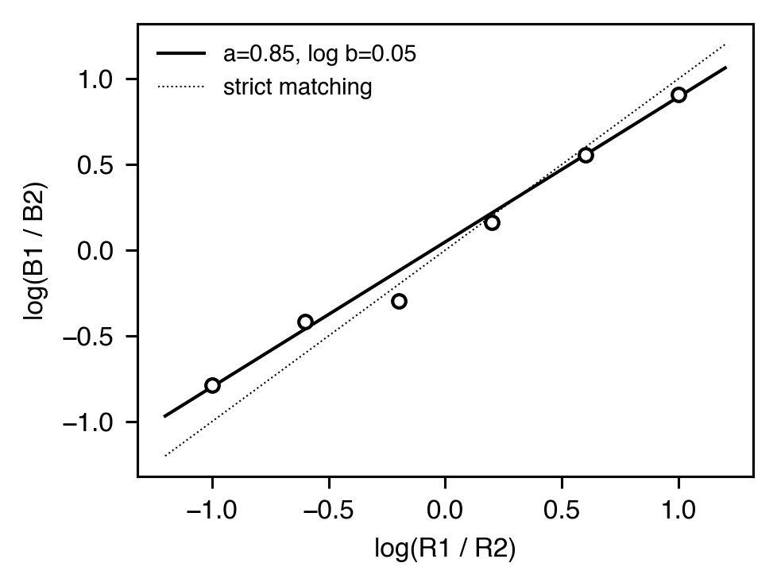
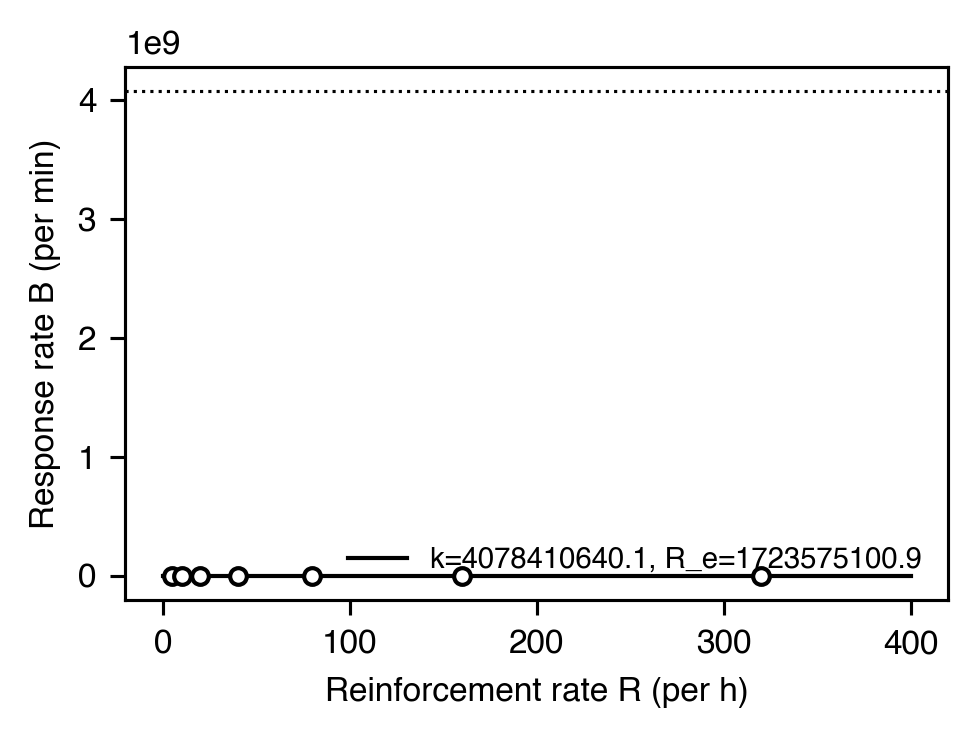
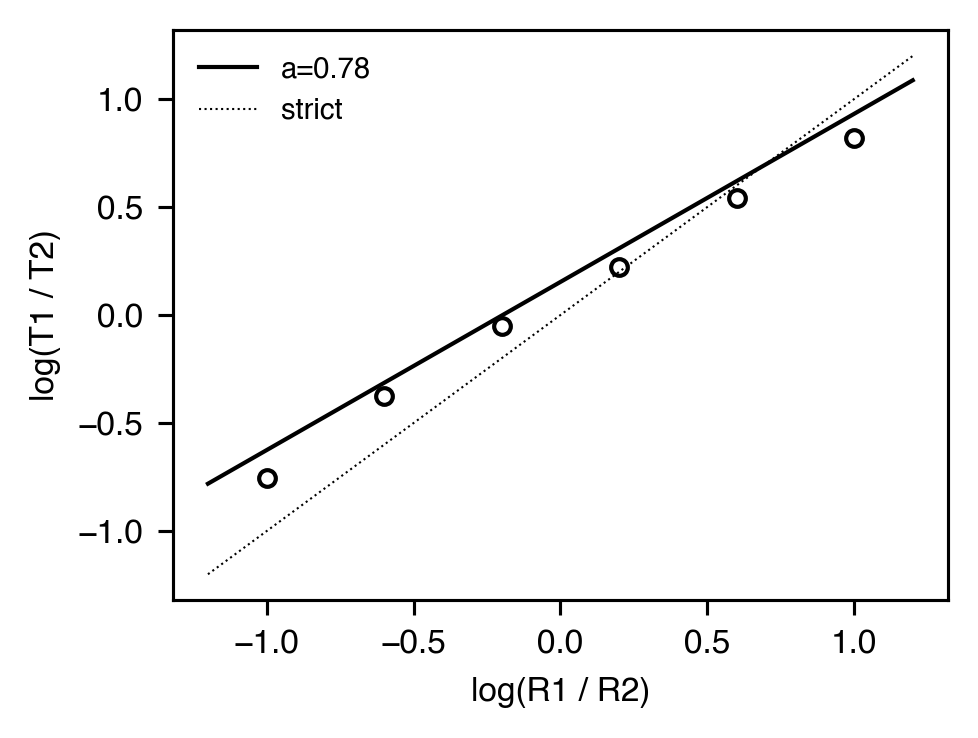
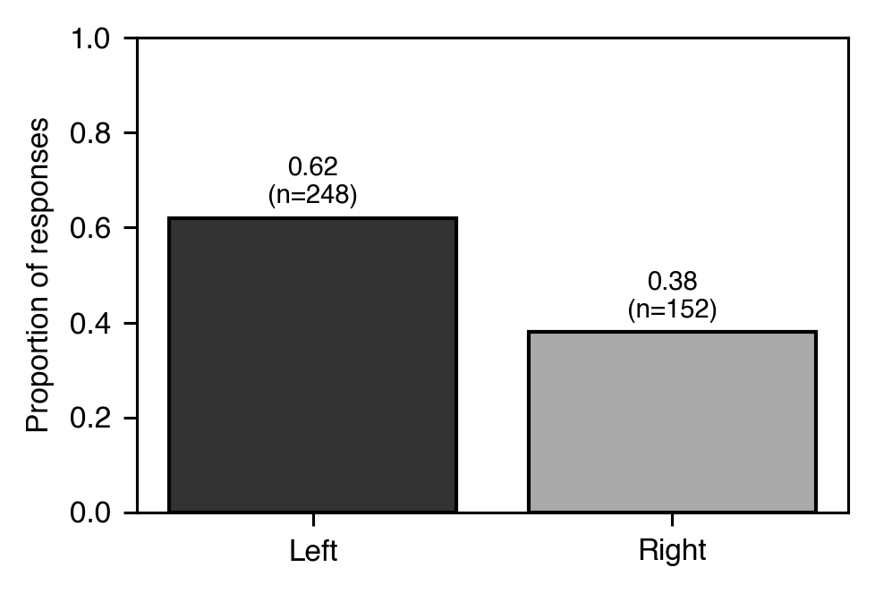
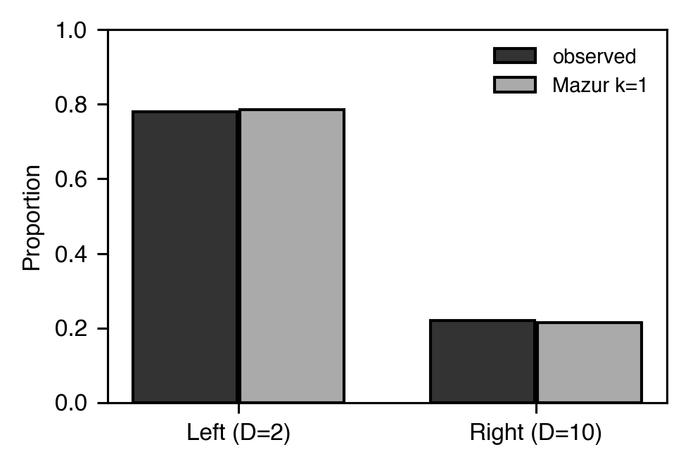
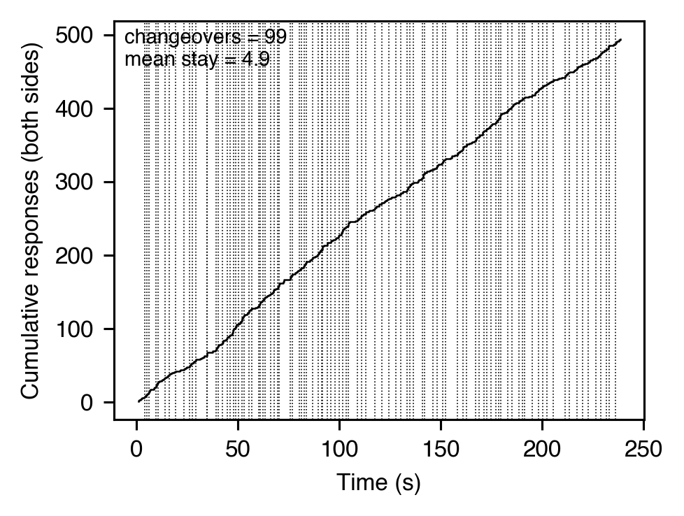
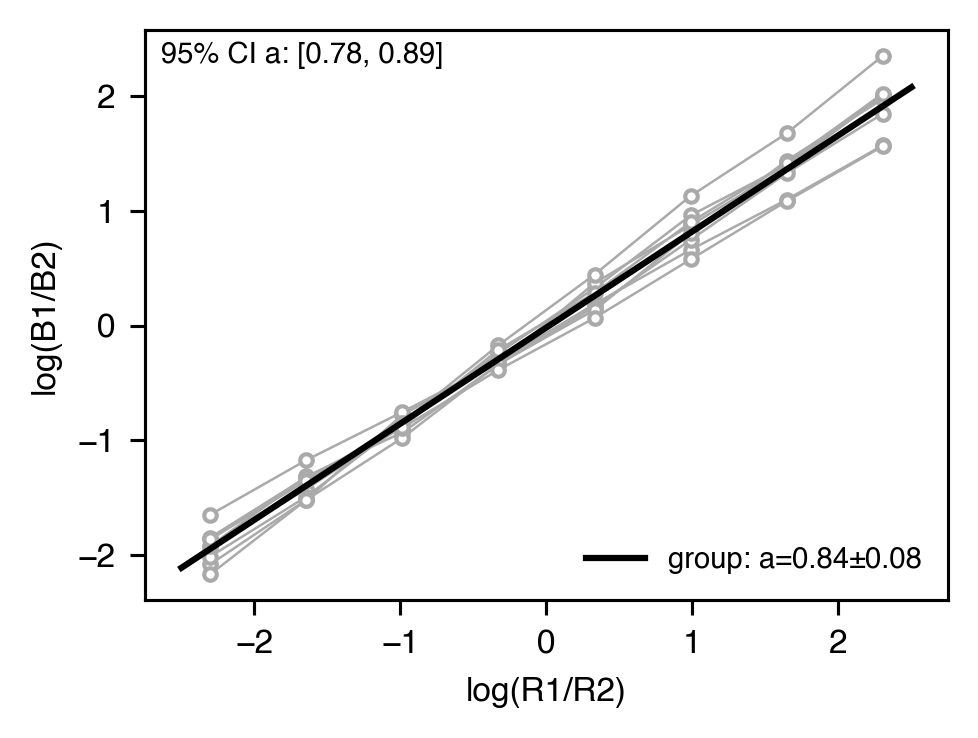
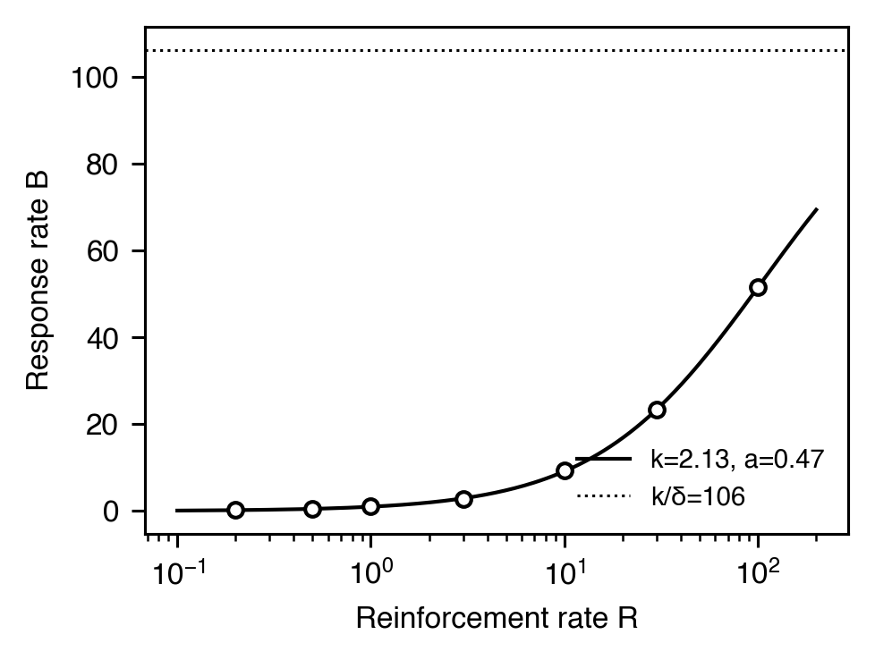

# Choice & matching

[← Catalog index](index.md) · [日本語版](../../ja/analyses/choice-and-matching.md)

How responding (or time) is allocated across two or more
simultaneously-available alternatives.

---

### `matching_law` — `MatchingParameters` (Generalized Matching Law)

- **Theme** — On concurrent schedules, subjects allocate responding in proportion to reinforcement. The Generalized Matching Law relaxes strict matching with a sensitivity `a` and bias `log b`. Undermatching (`a < 1`) is the most common empirical finding.
- **Equation** — `log(B1/B2) = a · log(R1/R2) + log b` (Baum, 1974). Natural logs; the papers usually report `log10 b` (= `bias / ln 10`)
- **Output** — `MatchingParameters(sensitivity=0.84, bias=0.02, r_squared=0.97, n=6)`
- **Reference** — Baum, W. M. (1974). On two types of deviation from the matching law. *JEAB*, 22(1), 231-242. <https://doi.org/10.1901/jeab.1974.22-231>

### Single-alternative matching — `SingleAlternativeMatchingParameters`

- **Theme** — Herrnstein (1970) showed that even on a single VI, response rate `B` is a hyperbolic function of reinforcement rate `R`, with `k` the asymptotic rate and `R_e` the extraneous reinforcement rate. Pharmacological studies often report `k` as the efficacy measure.
- **Equation** — `B = k · R / (R + R_e)`
- **Output** — `SingleAlternativeMatchingParameters(k=82.3, r_e=24.1, r_squared=0.93, n=8)`
- **Reference** — Herrnstein, R. J. (1970). On the law of effect. *JEAB*, 13(2), 243-266. <https://doi.org/10.1901/jeab.1970.13-243>

### Time-allocation matching — `TimeMatchingParameters`

- **Theme** — The matching law applies to the *time* spent on each alternative as well as to response counts. Time allocation is sometimes a more sensitive measure of preference than response allocation, especially when response topographies differ across alternatives or responses are not discrete.
- **Equation** — `log(T1 / T2) = a · log(R1 / R2) + log b` (Baum & Rachlin, 1969). Natural logs, as in `matching_law` (`log10 b` = `bias / ln 10`)
- **Output** — `TimeMatchingParameters(sensitivity=0.79, bias=0.05, r_squared=0.95, n=6)`
- **Reference** — Baum, W. M., & Rachlin, H. C. (1969). Choice as time allocation. *JEAB*, 12(6), 861-874. <https://doi.org/10.1901/jeab.1969.12-861>

### `choice_allocation` — `ChoiceAllocation` / `ExclusiveChoiceResult`

- **Theme** — Raw per-operandum response proportions. Useful as the baseline view before fitting a matching-law equation; also surfaces "exclusive choice" when allocation collapses onto one alternative (a common failure mode of undertraining or saturated preference).
- **Output** — `ChoiceAllocation(proportions=(0.62, 0.38), counts=(248, 152), total=400)` and `ExclusiveChoiceResult(is_exclusive=False, dominant_operandum=None, dominant_proportion=None, threshold=0.95)`
- **Reference** — Catania, A. C. (1966). Concurrent performances. *JEAB*, 9(3), 253-263. <https://doi.org/10.1901/jeab.1966.9-253>

### Concurrent-chains prediction — `ConcurrentChainsPrediction`

- **Theme** — On concurrent-chains schedules, terminal-link value is discounted hyperbolically and summed with initial-link effects. Mazur (2001) gives a single `k` that converts terminal-link delays and reinforcer magnitudes into preference predictions.
- **Equation** — `V = A / (1 + k · D)`; predicted `P(left) = V_L / (V_L + V_R)`
- **Output** — `ConcurrentChainsPrediction(v_left=0.12, v_right=0.07, predicted_proportion_left=0.63, observed_proportion_left=0.58, deviation=-0.05, k=0.05)`
- **Reference** — Mazur, J. E. (2001). Hyperbolic value addition and general models of animal choice. *Psychological Review*, 108(1), 96-112. <https://doi.org/10.1037/0033-295X.108.1.96>

### Stay-switch & COD — `StaySwitchMetrics` / `CODComplianceResult`

- **Theme** — Concurrent-schedule changeover behavior. `analyze_stay_switch` decomposes a side-tagged response sequence into stay bouts and reports changeover counts, mean stay length, and changeover rate per minute. `check_cod_compliance` reports the fraction of reinforcers preceded by a respect of the programmed COD window.
- **Output** — `StaySwitchMetrics(n_changeovers=24, n_stays=25, mean_stay_responses=4.0, mean_stay_duration_sec=1.5, changeover_rate_per_min=12.4, ...)` and `CODComplianceResult(cod_sec=2.0, n_reinforcers=18, n_compliant=14, compliance_rate=0.78)`
- **Reference** — Stubbs, D. A., & Pliskoff, S. S. (1969). Concurrent responding with fixed relative rate of reinforcement. *JEAB*, 12(6), 887-895. <https://doi.org/10.1901/jeab.1969.12-887>

### Hierarchical GML — `HierarchicalGMLFit`

- **Theme** — Empirical-Bayes random-effects fit of the GML across multiple subjects. Each subject has its own `(a_i, b_i)` drawn from `(N(μ_a, τ_a²), N(μ_b, τ_b²))`. Marginalising the subject-level Gaussians analytically gives a closed-form marginal log-likelihood for the hyperparameters, maximised by Nelder-Mead (maximum likelihood, not REML). Wald 95 % CIs on the group means use the GLS standard error at the estimate. Estimates, log-likelihood and standard errors agree with statsmodels `MixedLM` (random intercept plus an independent random slope, `reml=False`).
- **Output** — `HierarchicalGMLFit(mu_sensitivity=0.85, sd_sensitivity=0.10, mu_bias=0.02, sd_bias=0.06, sigma_obs=0.05, sensitivity_ci=(0.78, 0.92), bias_ci=(-0.02, 0.06), n_subjects=8, n_observations=64, log_likelihood=...)`
- **Reference** — Gelman, A., & Hill, J. (2007). *Data analysis using regression and multilevel/hierarchical models*. Cambridge University Press.

### Killeen MPR — `KilleenLawParameters`

- **Theme** — Killeen (1994) extends Herrnstein's hyperbola with a *coupling* parameter `δ` (response unit time): `B = (k a R) / (a R δ + 1)`. Asymptotic rate at `R → ∞` equals `k / δ`. Because `(a, k, δ)` are not separately identifiable from `(R, B)` data alone, `δ` must be supplied (typically the minimum observed IRT).
- **Equation** — `B = (k · a · R) / (a · R · δ + 1)`
- **Output** — `KilleenLawParameters(k=2.0, a=0.5, delta=0.02, r_squared=0.99, n=7)`
- **Reference** — Killeen, P. R. (1994). Mathematical principles of reinforcement. *Behavioral and Brain Sciences*, 17(1), 105-135. <https://doi.org/10.1017/S0140525X00033628>

