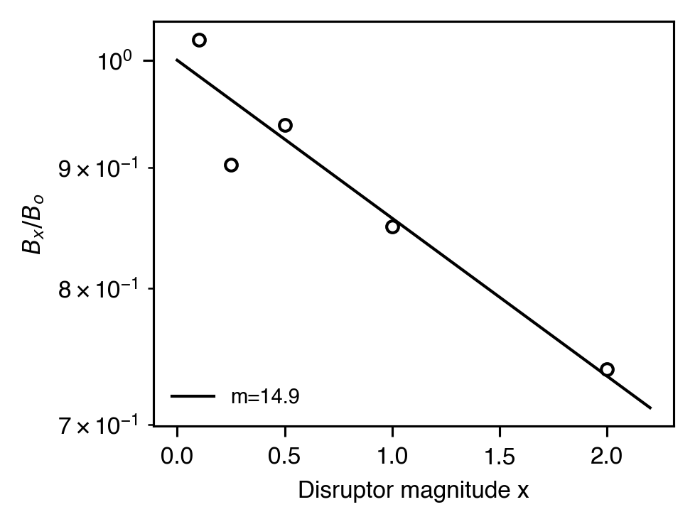
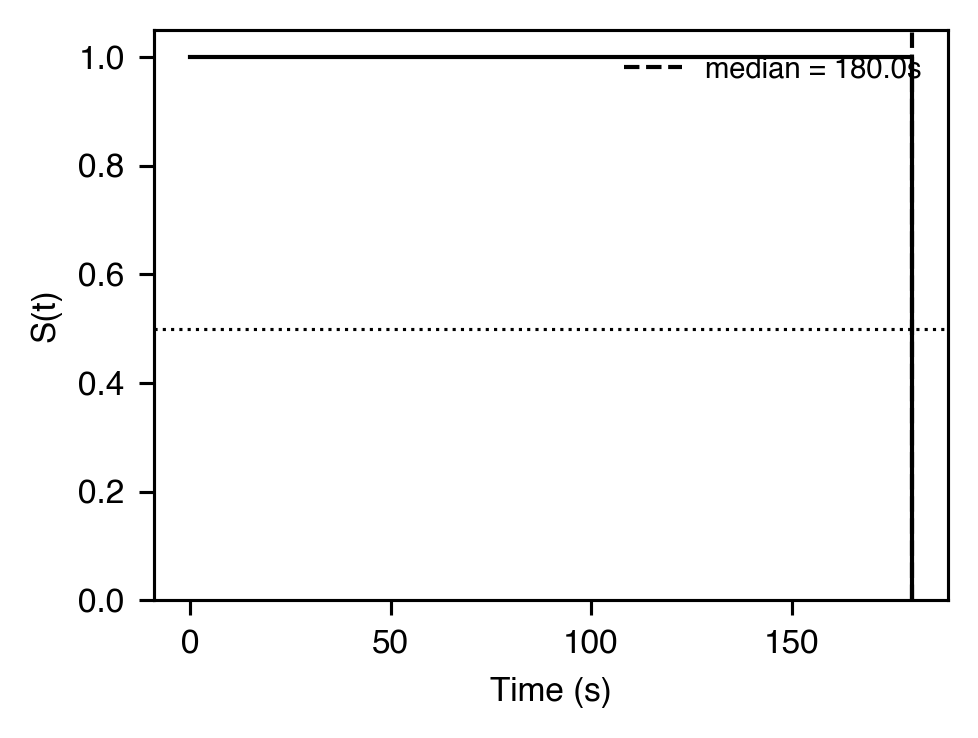

# Persistence & extinction

[← Catalog index](index.md) · [日本語版](../../ja/analyses/persistence-and-extinction.md)

How responding withstands disruptors, how it dies out under
extinction, and how it can recover via context change (renewal) or
withdrawal of an alternative (resurgence).

---

### `behavioral_momentum` — `MomentumParameters`

- **Theme** — Nevin (1992) cast resistance-to-change as behavioral mass: `log(B_x / B_o) = -x / m`, where `x` is a disruptor (pre-feeding, extinction duration, alternative reinforcement) and `m` the component-specific mass. Larger `m` = more persistent behavior.
- **Equation** — `log10(B_x / B_o) = -x / m`
- **Output** — `MomentumParameters(m=14.2, r_squared=0.91, n=5)`
- **Reference** — Nevin, J. A. (1992). An integrative model for the study of behavioral momentum. *JEAB*, 57(3), 301-316. <https://doi.org/10.1901/jeab.1992.57-301>

### `survival` — `SurvivalCurve` (Kaplan-Meier)

- **Theme** — Non-parametric estimate of the "survival" of a behavior under extinction — probability that a subject has not yet emitted the last response by time `t`. Handles right-censored observations.
- **Equation** — `S(t) = Π_{t_i ≤ t} (1 - d_i / n_i)`
- **Output** — `SurvivalCurve(times=(12.3, 45.8, ...), survival=(0.95, 0.80, ...), at_risk=(20, 16, ...), events=(1, 3, ...), n=20, n_events=18, median_survival_time=89.4)`
- **Reference** — Kaplan, E. L., & Meier, P. (1958). Nonparametric estimation from incomplete observations. *JASA*, 53(282), 457-481. <https://doi.org/10.1080/01621459.1958.10501452>

### Resurgence — `ResurgenceMetrics`

- **Theme** — In a 3-phase paradigm (Epstein, 1985; Shahan & Sweeney, 2011), the target response is reinforced (Phase 1), suppressed by DRA of an alternative (Phase 2), then both are extinguished (Phase 3). The target response transiently *resurges* in Phase 3. Reports the magnitude (test rate − suppression rate) and ratio (test rate / baseline rate) plus the alternative's own dynamics.
- **Output** — `ResurgenceMetrics(baseline_target_rate=42.7, suppression_target_rate=2.7, test_target_rate=15.0, resurgence_magnitude=12.3, resurgence_ratio=0.35, alt_baseline_rate=41.5, alt_test_rate=30.0, resurged=True, n_phase1=5, n_phase2=5, n_phase3=5)`
- **References** — Epstein, R. (1985). Extinction-induced resurgence. *Psychological Record*, 35(2), 143-153. — Shahan, T. A., & Sweeney, M. M. (2011). A model of resurgence based on behavioral momentum theory. *JEAB*, 95(1), 91-108. <https://doi.org/10.1901/jeab.2011.95-91>

### Renewal (ABA / ABC / AAB) — `RenewalMetrics`

- **Theme** — Renewal is the recovery of an extinguished response when the test context differs from the extinction context (Bouton, 2004). Three canonical designs: **ABA** (train A, extinguish B, test A), **ABC** (train A, extinguish B, test C), **AAB** (train A, extinguish A, test B). The analyzer takes three `PhaseSummary` records, classifies the design from context labels, and reports the renewal magnitude.
- **Equation** — `magnitude = test_rate − extinction_rate`; `ratio = test_rate / train_rate`
- **Output** — `RenewalMetrics(design="ABA", contexts=("A", "B", "A"), train_rate=1.0, extinction_terminal_rate=0.1, test_rate=0.5, renewal_magnitude=0.4, renewal_ratio=0.5, renewed=True)`
- **References** — Bouton, M. E. (2004). Context and behavioral processes in extinction. *Learning & Memory*, 11(5), 485-494. <https://doi.org/10.1101/lm.78804> — Bouton, M. E., & Bolles, R. C. (1979). Contextual control of the extinction of conditioned fear. *Learning and Motivation*, 10(4), 445-466. <https://doi.org/10.1016/0023-9690(79)90057-2>

> Recording note: ``session-recorder`` emits ``phase_enter`` and
> ``phase_exit`` records (in OKL v1 wire format) carrying optional
> context coordinates (``name`` / ``time`` / ``location`` / ``cue``);
> downstream callers turn these into the ``PhaseSummary`` list this
> analyzer consumes.
