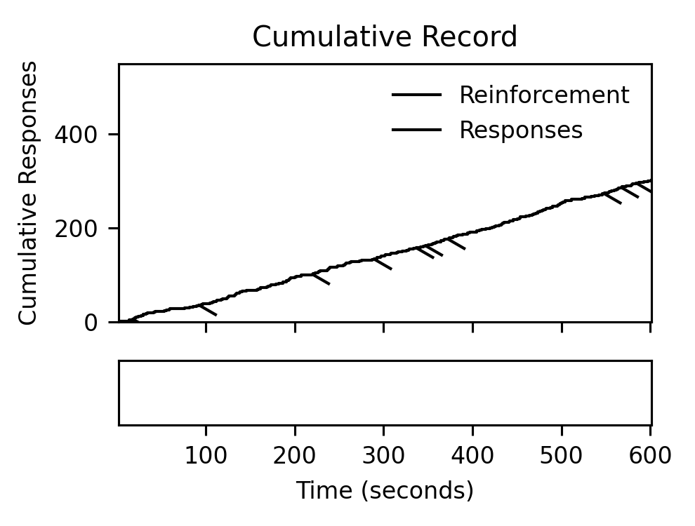
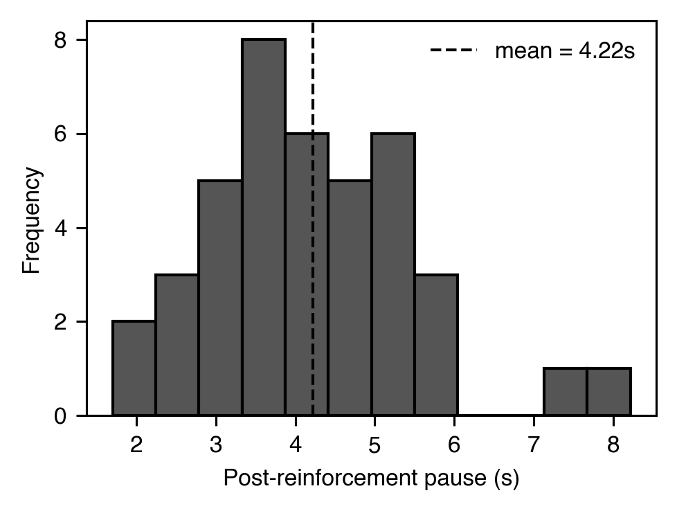
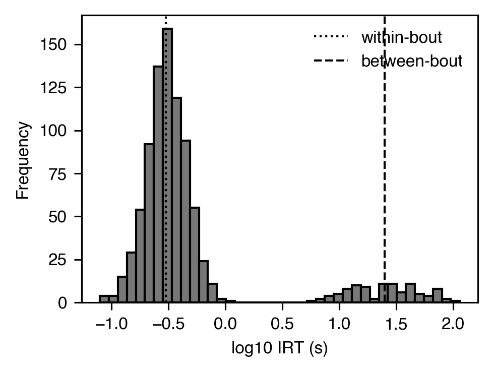
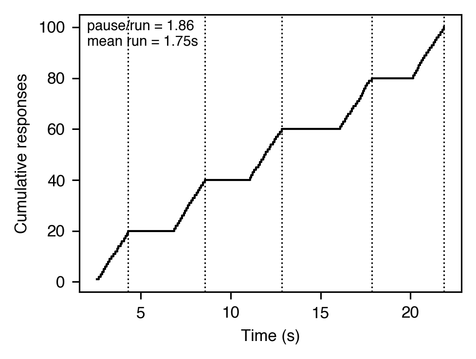
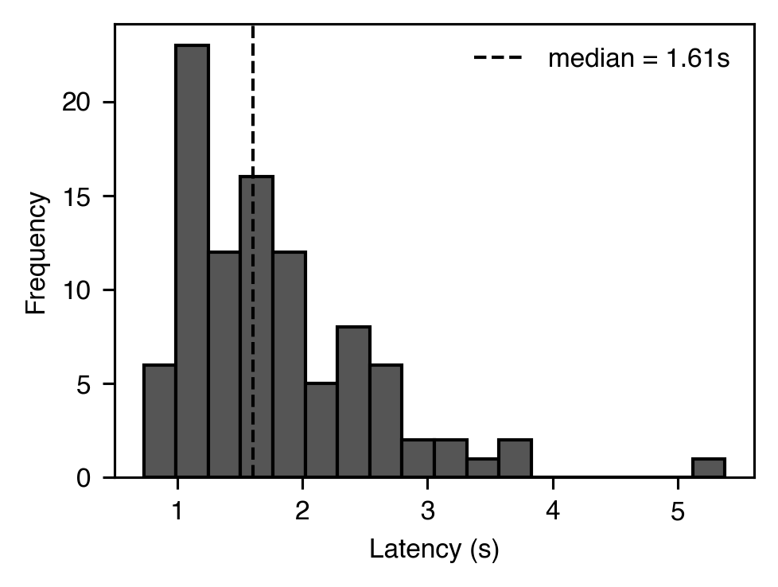

# Response rate & local pattern

[← Catalog index](index.md) · [日本語版](../../ja/analyses/rate-and-pattern.md)

Visualizations and statistics that summarise *when* responses occur
within a session and *how* they are clustered locally.

---

### `cumulative_record`

- **Theme** — Canonical Skinnerian plot. Cumulative responses as a function of time, with tick marks at reinforcer deliveries. The slope at any point is the local response rate; pauses and breaks-and-runs are visually obvious.
- **Equation** — `y(t) = sum_{i: t_i <= t} 1(response_i)`
- **Module** — `session_analyzer.visualizer.cumulative_record.plot_cumulative_record`
- **Output** — A matplotlib `Axes` with y = cumulative responses, x = time (s), vertical dashes on the curve at each reinforcer.
- **Reference** — Ferster, C. B., & Skinner, B. F. (1957). *Schedules of reinforcement*. Appleton-Century-Crofts.

### `post_reinforcement_pause` — `PRPMetrics`

- **Theme** — Under interval and ratio schedules, responding typically ceases for a period right after each reinforcer. The duration of that pause scales with ratio size (Felton & Lyon, 1966) and is a classic index of schedule control.
- **Equation** — `PRP_i = t(first response after SR_i) - t(SR_i)`
- **Output** — `PRPMetrics(mean=4.12, median=3.80, std=1.55, min=0.90, max=9.40, n=42)` (seconds)
- **Reference** — Felton, M., & Lyon, D. O. (1966). The post-reinforcement pause. *JEAB*, 9(2), 131-134. <https://doi.org/10.1901/jeab.1966.9-131>

Related: `compute_quarter_life(responses, deadline)` returns the time
at which the subject has emitted 25 % of the final response count
within a bin — a scale-free index of FI scalloping (Herrnstein &
Morse, 1957).

### `irt_distribution` — bout decomposition via `BoutMetrics`

- **Theme** — Operant responding on VI / DRL is not Poisson: IRTs are a mixture of **within-bout** (short, fast) and **between-bout** (long, deliberation) components. Shull et al. (2001) recovered this with a two-log-normal EM mixture.
- **Equation** — `p(IRT) = π · lognormal(μ_w, σ_w) + (1-π) · lognormal(μ_b, σ_b)`
- **Output** — `BoutMetrics(bout_initiation_rate=2.3, within_bout_rate=3.1, mean_bout_length=6.4, mean_inter_bout_interval_sec=26.1, within_bout_irt_sec=0.31, within_bout_log_sigma=0.48, inter_bout_log_sigma=0.72, pi_within=0.84, n_irts=512, converged=True)`
- **Reference** — Shull, R. L., Gaynor, S. T., & Grimes, J. A. (2001). Response rate viewed as engagement bouts. *JEAB*, 75(3), 247-274. <https://doi.org/10.1901/jeab.2001.75-247>

### `log_survivor` — `LogSurvivorCurve` / `LogSurvivorBilinearFit`

- **Theme** — The empirical survival function of IRTs plotted on a log scale (Shull, 1991). A linear plot is consistent with a single Poisson process; a bilinear ("broken-line") plot is the canonical signature of bout structure. The bilinear fit returns the knot time and the two slopes (steeper = within-bout rate; shallower = inter-bout rate).
- **Equation** — `S(t) = P(IRT > t)`; bilinear fit minimises `Σ (log S(t) − [a₁ t + b₁])² + Σ (log S(t) − [a₂ t + b₂])²` over the optimal knot index.
- **Output** — `LogSurvivorBilinearFit(knot_time_sec=0.62, slope_fast=-3.1, slope_slow=-0.18, intercept_fast=-0.04, intercept_slow=-1.2, sse=0.07, n_irts=400)`
- **Reference** — Shull, R. L. (1991). Mathematical description of operant behavior. In I. H. Iversen & K. A. Lattal (Eds.), *Experimental analysis of behavior* (Vol. 2, pp. 243-282). Elsevier.

### `run_length` — `RunMetrics`

- **Theme** — FR schedules produce "pause-then-run" cycles: a post-reinforcement pause, then a rapid burst to completion. Decomposing these lets you see whether an intervention slows the pause, the run, or both.
- **Output** — `RunMetrics(n_runs=48, mean_run_length=20.0, mean_run_duration=1.82, mean_run_rate=10.99, mean_pause_duration=3.41, pause_to_run_ratio=1.87)`
- **Reference** — Schlinger, H. D., Derenne, A., & Baron, A. (2008). What 50 years of research tell us about pausing under ratio schedules. *The Behavior Analyst*, 31(1), 39-60. <https://doi.org/10.1007/BF03392160>

### `latency` — `LatencyMetrics`

- **Theme** — Time from stimulus onset (or trial start) to the first response. Short latencies signal strong stimulus control; long latencies suggest extinction, satiation, or poor discrimination.
- **Output** — `LatencyMetrics(mean=2.05, median=1.78, std=0.81, min=0.42, max=6.10, n=96)` (seconds)
- **Reference** — Standard descriptor — see e.g. Blough, D. S. (1956). *JEAB*, 3(1), 3-13. <https://doi.org/10.1901/jeab.1960.3-3>

