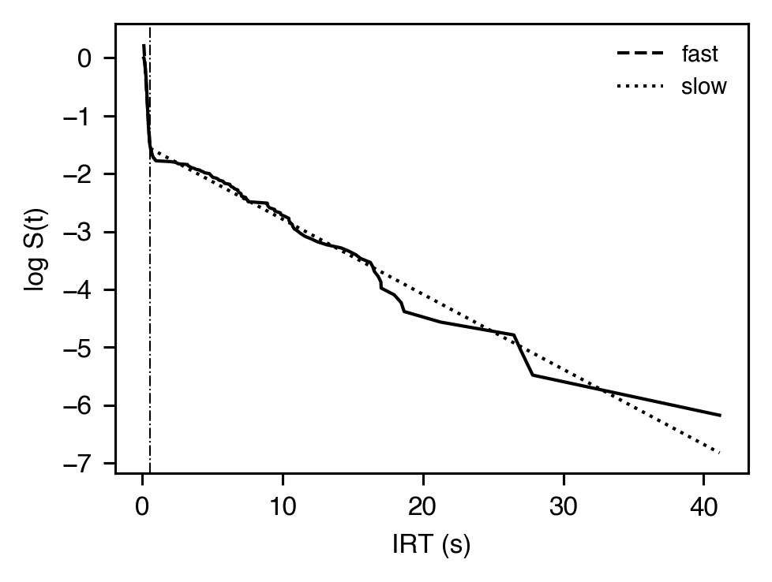
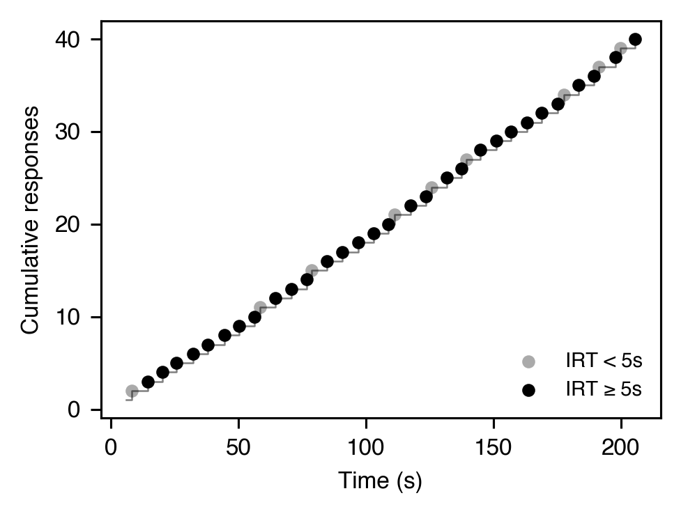
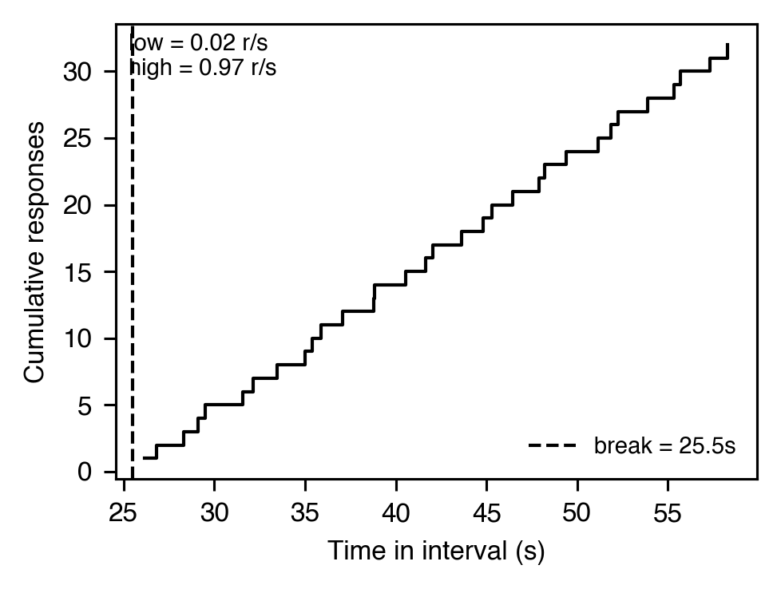
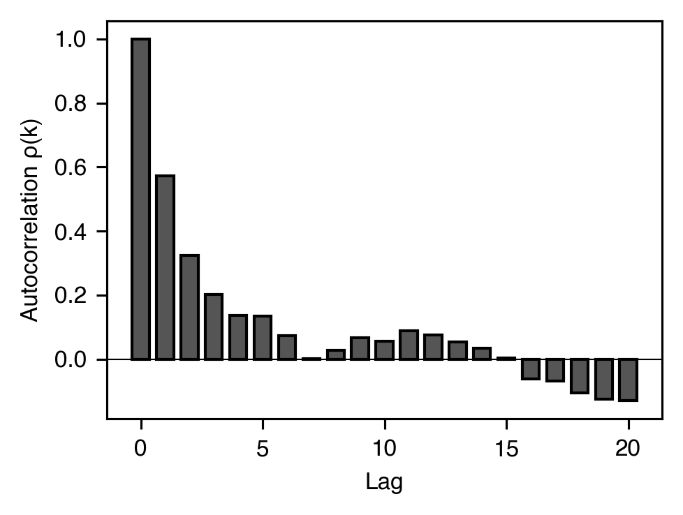
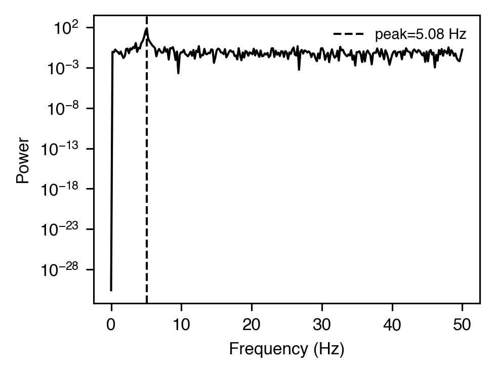
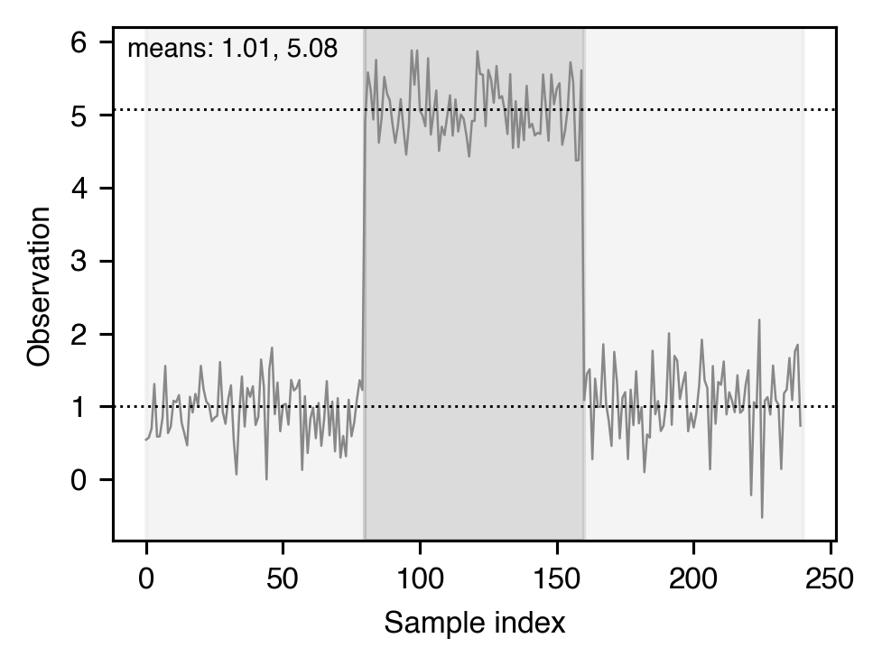

# Response rate & local pattern

[← Catalog index](index.md) · [日本語版](../../ja/analyses/rate-and-pattern.md)

Visualizations and statistics that summarise *when* responses occur
within a session and *how* they are clustered locally.

---

### `cumulative_record`

- **Theme** — Canonical Skinnerian plot. Cumulative responses as a function of time, with tick marks at reinforcer deliveries. The slope at any point is the local response rate; pauses and breaks-and-runs are visually obvious.
- **Equation** — `y(t) = sum_{i: t_i <= t} 1(response_i)`
- **Module** — `session_analyzer.visualizer.cumulative_record.plot_cumulative_record`
- **Output** — A matplotlib `Axes` with y = cumulative responses, x = time (s), vertical dashes on the curve at each reinforcer.
- **Reference** — Ferster, C. B., & Skinner, B. F. (1957). *Schedules of reinforcement*. Appleton-Century-Crofts.

### `post_reinforcement_pause` — `PRPMetrics`

- **Theme** — Under interval and ratio schedules, responding typically ceases for a period right after each reinforcer. The duration of that pause scales with ratio size (Felton & Lyon, 1966) and is a classic index of schedule control.
- **Equation** — `PRP_i = t(first response after SR_i) - t(SR_i)`
- **Output** — `PRPMetrics(mean=4.12, median=3.80, std=1.55, min=0.90, max=9.40, n=42)` (seconds)
- **Reference** — Felton, M., & Lyon, D. O. (1966). The post-reinforcement pause. *JEAB*, 9(2), 131-134. <https://doi.org/10.1901/jeab.1966.9-131>

Related: `compute_quarter_life(reinforcement_times, response_times)`
returns, for each inter-reinforcement interval, the fraction of the
interval elapsed when 25 % of that interval's responses have occurred
— a scale-free index of FI scalloping (Herrnstein & Morse, 1957).
Uniform responding gives about 0.25; values well above 0.25 indicate a
scallop.

### `irt_distribution` — bout decomposition via `BoutMetrics`

- **Theme** — Operant responding on VI / DRL is not Poisson: IRTs are a mixture of **within-bout** (short, fast) and **between-bout** (long, deliberation) components. Shull et al. (2001) recovered this with a two-log-normal EM mixture.
- **Equation** — `p(IRT) = π · lognormal(μ_w, σ_w) + (1-π) · lognormal(μ_b, σ_b)`
- **Output** — `BoutMetrics(bout_initiation_rate=2.3, within_bout_rate=3.1, mean_bout_length=6.4, mean_inter_bout_interval_sec=26.1, within_bout_irt_sec=0.31, within_bout_log_sigma=0.48, inter_bout_log_sigma=0.72, pi_within=0.84, n_irts=512, converged=True)`
- **Reference** — Shull, R. L., Gaynor, S. T., & Grimes, J. A. (2001). Response rate viewed as engagement bouts. *JEAB*, 75(3), 247-274. <https://doi.org/10.1901/jeab.2001.75-247>

### `log_survivor` — `LogSurvivorCurve` / `LogSurvivorBilinearFit`

- **Theme** — The empirical survival function of IRTs plotted on a log scale (Shull, 1991). A linear plot is consistent with a single Poisson process; a bilinear ("broken-line") plot is the canonical signature of bout structure. The bilinear fit returns the knot time and the two slopes (steeper = within-bout rate; shallower = inter-bout rate).
- **Equation** — `S(t) = P(IRT > t)`; bilinear fit minimises `Σ (log S(t) − [a₁ t + b₁])² + Σ (log S(t) − [a₂ t + b₂])²` over the optimal knot index.
- **Output** — `LogSurvivorBilinearFit(knot_time_sec=0.62, slope_fast=-3.1, slope_slow=-0.18, intercept_fast=-0.04, intercept_slow=-1.2, sse=0.07, n_irts=400)`
- **Reference** — Shull, R. L. (1991). Mathematical description of operant behavior. In I. H. Iversen & K. A. Lattal (Eds.), *Experimental analysis of behavior* (Vol. 2, pp. 243-282). Elsevier.

### `run_length` — `RunMetrics`

- **Theme** — FR schedules produce "pause-then-run" cycles: a post-reinforcement pause, then a rapid burst to completion. Decomposing these lets you see whether an intervention slows the pause, the run, or both.
- **Output** — `RunMetrics(n_runs=48, mean_run_length=20.0, mean_run_duration=1.82, mean_run_rate=10.99, mean_pause_duration=3.41, pause_to_run_ratio=1.87)`
- **Reference** — Schlinger, H. D., Derenne, A., & Baron, A. (2008). What 50 years of research tell us about pausing under ratio schedules. *The Behavior Analyst*, 31(1), 39-60. <https://doi.org/10.1007/BF03392160>

### `latency` — `LatencyMetrics`

- **Theme** — Time from stimulus onset (or trial start) to the first response. Short latencies signal strong stimulus control; long latencies suggest extinction, satiation, or poor discrimination.
- **Output** — `LatencyMetrics(mean=2.05, median=1.78, std=0.81, min=0.42, max=6.10, n=96)` (seconds)
- **Reference** — Standard descriptor — see e.g. Blough, D. S. (1956). *JEAB*, 3(1), 3-13. <https://doi.org/10.1901/jeab.1960.3-3>

### IRT-coded cumulative record — `plot_irt_coded_cumulative_record`

- **Theme** — Cumulative response trace where each response point is colour-coded by its preceding IRT relative to a threshold (e.g., the DRL criterion). Short IRTs (failures) and long IRTs (passes) are visible at a glance.
- **Module** — `session_analyzer.visualizer.cumulative_diff.plot_irt_coded_cumulative_record`
- **Reference** — Standard DRL/DRO visualization convention (Sidman, 1956; Reynolds, 1968).

### Schneider two-state segmentation — `SchneiderTwoStateResult`

- **Theme** — Schneider (1969) modelled FI cumulative records as two states — pause then run. Following his numerical procedure, the cumulative record of one inter-reinforcement interval is fitted by least squares with a line through the origin up to the breakpoint and a second line joined to it at the breakpoint; the breakpoint is moved along a grid of the interval and the one with the smallest sum of squared deviations is kept. Both fitted rates are kept non-negative, and state 1 may hold no responses.
- **Output** — `SchneiderTwoStateResult(break_time=25.5, pause_duration=25.5, run_duration=34.5, low_rate=0.02, high_rate=0.97, slope_difference=0.95, n_low=0, n_high=32)`
- **Reference** — Schneider, B. A. (1969). A two-state analysis of fixed-interval responding in the pigeon. *JEAB*, 12(5), 677-687. <https://doi.org/10.1901/jeab.1969.12-677>

### IRT autocorrelation — `IRTAutocorrelation`

- **Theme** — Biased autocorrelation of the IRT series, `ρ(k) = E[(x_t − μ)(x_{t+k} − μ)] / σ²`. Positive `ρ(1)` reveals lingering effects of the previous IRT (e.g., bouts); negative `ρ(1)` signals alternation. Longer-lag structure picks up periodicity.
- **Output** — `IRTAutocorrelation(lags=(0, 1, 2, ..., 20), values=(1.0, 0.58, 0.32, ..., 0.02), n=400)`
- **Reference** — Wei, W. W. S. (2006). *Time series analysis* (2nd ed.). Pearson.

### IRT spectrum — `IRTSpectrum`

- **Theme** — One-sided periodogram of the mean-centred IRT series. Schedule-induced rhythms (e.g., timing or alternation) appear as peaks at characteristic frequencies.
- **Output** — `IRTSpectrum(frequencies=(0.0, 0.2, 0.4, ..., 50.0), power=(0.001, 0.002, ..., 0.05, ...), peak_frequency=5.00, n=512, sampling_rate=100.0)`
- **Reference** — Wei, W. W. S. (2006). *Time series analysis* (2nd ed.). Pearson.

### Gaussian HMM segmentation — `GaussianHMMFit`

- **Theme** — Generalises Schneider's two-state model to a `K`-state Gaussian HMM trained by Baum-Welch and decoded by Viterbi. Suitable for non-stationary regime detection beyond fixed pause/run schedules.
- **Output** — `GaussianHMMFit(pi=(...), transition_matrix=((...),(...)), means=(1.0, 5.0), sigmas=(0.4, 0.4), log_likelihood=-220.0, state_sequence=(0, 0, ..., 1, 1, ..., 0), segments=(...), n=240, n_iterations=18, converged=True)`
- **Reference** — Rabiner, L. R. (1989). A tutorial on hidden Markov models. *Proceedings of the IEEE*, 77(2), 257-286. <https://doi.org/10.1109/5.18626>

