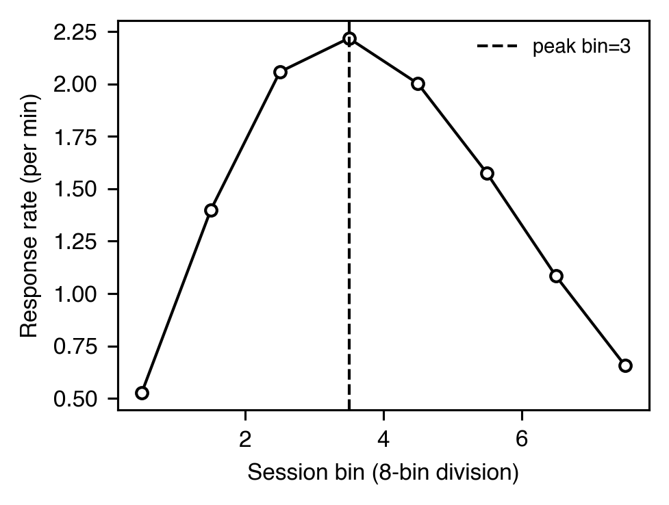
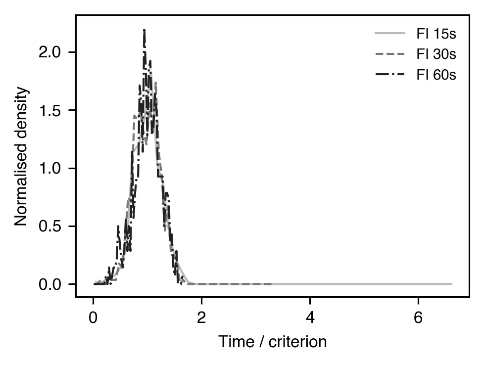
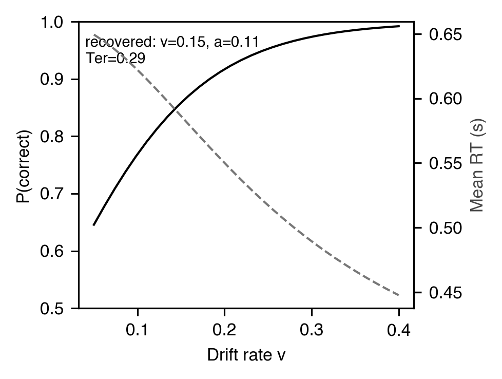
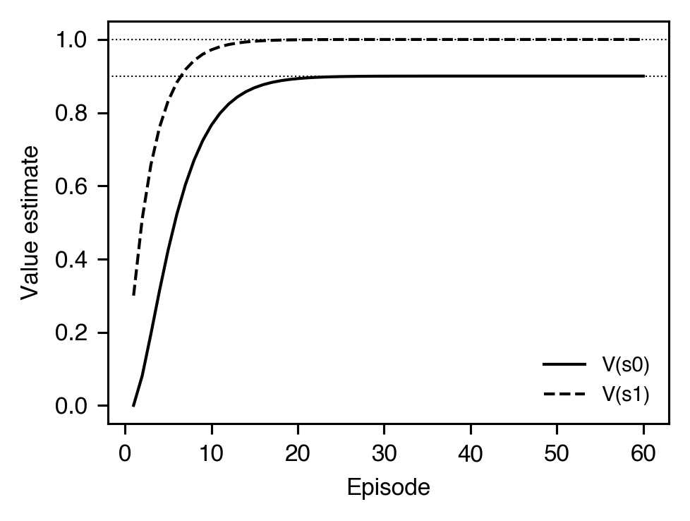

# Temporal

[← Catalog index](index.md) · [日本語版](../../ja/analyses/temporal.md)

Time-of-response analyses: how responding tracks the temporal
structure of the schedule and how it evolves across the session.

---

### `peak_procedure_binned` — `PeakTrialBinnedMetrics`

- **Theme** — On peak trials (no reinforcer), response rate rises, peaks near the expected time, and falls — the "internal clock" signature. Binned rate analysis yields peak time, peak rate, and spread.
- **Output** — `PeakTrialBinnedMetrics(peak_time=30.2, peak_rate=1.24, start_time=18.7, stop_time=42.8, spread=24.1, middle_time=30.75, n_responses=58, bin_width=1.0)`
- **Reference** — Roberts, S. (1981). Isolation of an internal clock. *J. Exp. Psychol.: ABP*, 7(3), 242-268. <https://doi.org/10.1037/0097-7403.7.3.242>

### `peak_procedure_mle` — `PeakTrialMLEMetrics` (three-state MLE, **heavy tier**)

- **Theme** — Church, Meck, & Gibbon (1994) model the peak trial as three Poisson states — low, high, low — and fit two switch times `(s1, s2)` by MLE. This gives trial-level transition times rather than grand-averaged bins.
- **Output** — `PeakTrialMLEMetrics(start_time=20.1, stop_time=41.5, high_rate=1.82, low_rate=0.21, middle_time=30.8, spread=21.4, n_responses=58, log_likelihood=-132.7)`
- **Reference** — Church, R. M., Meck, W. H., & Gibbon, J. (1994). Application of scalar timing theory to individual trials. *J. Exp. Psychol.: ABP*, 20(2), 135-155. <https://doi.org/10.1037/0097-7403.20.2.135>

### Within-session dynamics — `WithinSessionDynamics`

- **Theme** — Response rate within a session typically follows an inverted-U (McSweeney, Roll, & Cannon, 1994): a brief warm-up rise, a peak, and a satiation-driven decline. The bin trajectory and the rise/fall slopes characterize this trajectory and let the user separate motivational depletion from rate-control proper.
- **Output** — `WithinSessionDynamics(rates=[0.5, 1.4, 2.1, 2.4, 2.0, 1.5, 1.0, 0.7], peak_bin=3, peak_rate=2.4, rise_slope=0.62, fall_slope=-0.34, bilinear_r_squared=0.96, n_bins=8, n_responses=240)`
- **Reference** — McSweeney, F. K., Roll, J. M., & Cannon, C. B. (1994). The generality of within-session patterns of responding. *Animal Learning & Behavior*, 22(3), 252-266. <https://doi.org/10.3758/BF03209833>

### Scalar timing — `ScalarTimingResult` / `ScalarPropertyTest`

- **Theme** — Scalar Expectancy Theory (Gibbon, 1977) predicts that response distributions on temporal-discrimination tasks satisfy the *scalar property*: standard deviation grows linearly with the mean, so the coefficient of variation (CV) is constant across criterion durations.
- **Equation** — `CV = σ / μ`; scalar property holds iff `std(CVs) / mean(CVs) <= tolerance`
- **Output** — `ScalarTimingResult(mean=30.0, std=7.5, coefficient_of_variation=0.25, n=500)` and `ScalarPropertyTest(criteria=(15.0, 30.0, 60.0), cvs=(0.25, 0.25, 0.25), mean_cv=0.25, cv_of_cvs=0.005, is_scalar=True, tolerance=0.20)`
- **Reference** — Gibbon, J. (1977). Scalar expectancy theory and Weber's law in animal timing. *Psychological Review*, 84(3), 279-325. <https://doi.org/10.1037/0033-295X.84.3.279>

### Drift-diffusion (EZ-DDM) — `EZDiffusionParameters`

- **Theme** — Closed-form recovery of the three core diffusion-model parameters from accuracy and RT moments (Wagenmakers et al., 2007). Useful when full likelihood-based DDM is overkill — EZ delivers `(v, a, Ter)` from a single triple `(Pc, MRT, VRT)`.
- **Output** — `EZDiffusionParameters(v=0.20, a=0.12, ter=0.30, s=0.1)`
- **Reference** — Wagenmakers, E.-J., van der Maas, H. L. J., & Grasman, R. P. P. P. (2007). An EZ-diffusion model for response time and accuracy. *Psychonomic Bulletin & Review*, 14(1), 3-22. <https://doi.org/10.3758/BF03194023>

### TD(0) learning — `TDLearningTrace`

- **Theme** — Tabular temporal-difference value learning (Sutton, 1988). For a fixed state-reward trajectory, `simulate_td_zero` runs one pass of `δ_t = r + γ V(s_{t+1}) − V(s_t)`; `V(s_t) ← V(s_t) + α δ_t`. Useful as the substrate for prediction-error accounts of dopamine (Schultz, Dayan, & Montague, 1997).
- **Output** — `TDLearningTrace(values=(1.0, 1.0, 0.0), errors=(0.0, 1.0), alpha=1.0, gamma=1.0, n_steps=2)`
- **Reference** — Sutton, R. S. (1988). Learning to predict by the methods of temporal differences. *Machine Learning*, 3(1), 9-44. <https://doi.org/10.1007/BF00115009>

