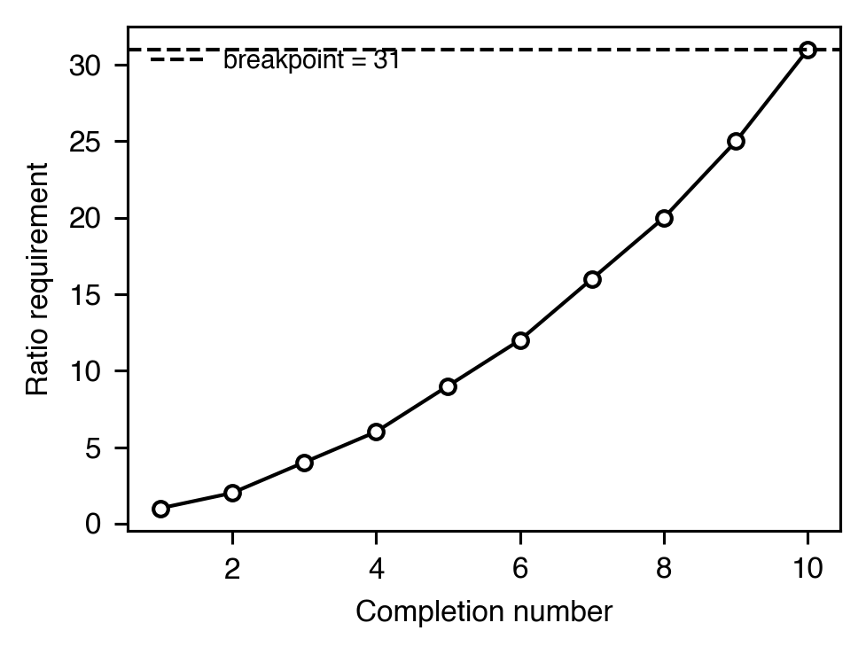
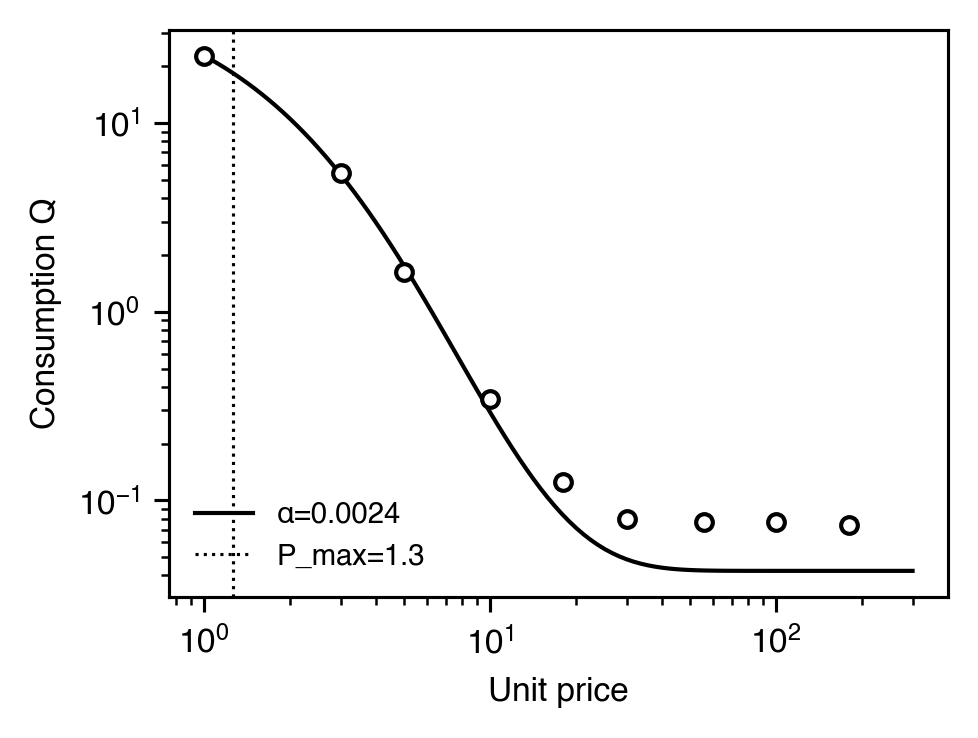
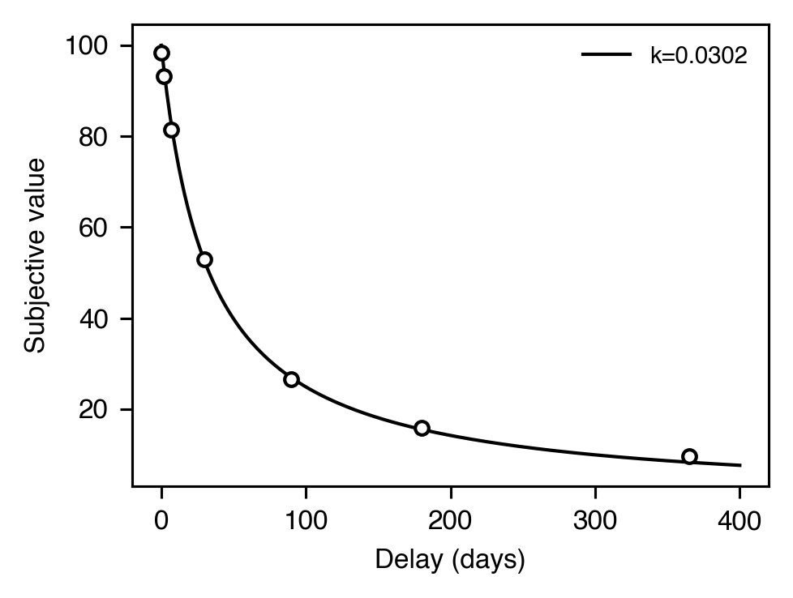

# Value & economics

[← Catalog index](index.md) · [日本語版](../../ja/analyses/value-and-economics.md)

Reinforcer-value indices: how much work the subject is willing to
emit, how steeply value is discounted by delay or price, and where
indifference between two options sits.

---

### `breakpoint` — `BreakpointResult` (Progressive Ratio)

- **Theme** — Under a PR schedule the ratio requirement escalates until the subject pauses long enough to declare session-over. The last completed ratio — the **breakpoint** — indexes reinforcer efficacy. Drug self-administration and rodent behavioral economics both lean on this measure.
- **Output** — `BreakpointResult(breakpoint_ratio=28, n_ratios_completed=12, terminal_pause_sec=312.4, threshold_sec=300.0, method="pause_threshold")`
- **Reference** — Richardson, N. R., & Roberts, D. C. S. (1996). Progressive ratio schedules in drug self-administration studies in rats. *Journal of Neuroscience Methods*, 66(1), 1-11. <https://doi.org/10.1016/0165-0270(95)00153-0>

### `demand_curve` — `DemandParameters` (Exponential demand, **heavy tier**)

- **Theme** — Consumption `Q` as a function of unit price `P`. Hursh & Silberberg (2008) introduced a three-parameter exponential that yields an essential-value index (`1/α`). Standard in behavioral economics of drug reinforcers and food choice.
- **Equation** — `log10 Q = log10 Q0 + k · (exp(-α · Q0 · P) - 1)`
- **Output** — `DemandParameters(q0=62.1, alpha=0.0023, k=2.9, r_squared=0.96, n=10, p_max=18.7, o_max=1162.0)`
- **Reference** — Hursh, S. R., & Silberberg, A. (2008). Economic demand and essential value. *Psychological Review*, 115(1), 186-198. <https://doi.org/10.1037/0033-295X.115.1.186>

### Unit-price elasticity — `UnitPriceElasticity`

- **Theme** — Companion to the exponential demand fit: a plain log-log OLS slope ``α`` of consumption on unit price (`unit price = responses / dose`). Two operations sharing a unit price are predicted to support the same consumption (Hursh, 1980, 1991). `|α| > 1` is *elastic*, `|α| < 1` is *inelastic*.
- **Equation** — `log Q = α · log P + c`
- **Output** — `UnitPriceElasticity(elasticity=-1.18, intercept=4.05, r_squared=0.99, n=8, is_elastic=True, is_inelastic=False)`
- **Reference** — Hursh, S. R. (1980). Economic concepts for the analysis of behavior. *JEAB*, 34(2), 219-238. <https://doi.org/10.1901/jeab.1980.34-219>

### Cross-price elasticity — `CrossPriceElasticity`

- **Theme** — Slope of `log Q_A` on `log P_B` — how the consumption of reinforcer A depends on the price of reinforcer B. Positive → substitutes; negative → complements; near zero → independent (Hursh & Roma, 2013).
- **Output** — `CrossPriceElasticity(elasticity=0.62, intercept=2.31, r_squared=0.96, n=6, relationship="substitutes")`
- **Reference** — Hursh, S. R., & Roma, P. G. (2013). Behavioral economics and empirical public policy. *JEAB*, 99(1), 98-124. <https://doi.org/10.1002/jeab.7>

### Delay discounting — `HyperbolicDiscountingParameters` / `HyperboloidDiscountingParameters`

- **Theme** — How a reinforcer's subjective value falls with delay. Mazur's hyperbolic is the animal-standard; Rachlin's hyperboloid adds an `s` exponent, accommodating non-linear time perception found in human data. Larger `k` = steeper discounting (more impulsive).
- **Equation** — Hyperbolic `V = A / (1 + k·D)` · Hyperboloid `V = A / (1 + k·D)^s`
- **Output (hyperbolic)** — `HyperbolicDiscountingParameters(k=0.031, r_squared=0.95, n=7)`
- **Output (hyperboloid)** — `HyperboloidDiscountingParameters(k=0.022, s=0.81, r_squared=0.97, n=7)`
- **References** — Mazur, J. E. (1987). In *Quantitative analyses of behavior, Vol. 5*. — Rachlin, H. (2006). Notes on discounting. *JEAB*, 85(3), 425-435. <https://doi.org/10.1901/jeab.2006.85-05>

### Adjusting indifference point — `IndifferencePoint`

- **Theme** — In an *adjusting-amount* (or *adjusting-delay*) procedure (Mazur, 1987), the dimension being titrated is incremented or decremented as a function of the subject's choice between an immediate and a delayed reinforcer. The procedure converges on the value at which the subject is indifferent. `IndifferencePoint` returns the mean over a trailing stable window plus a stability flag.
- **Output** — `IndifferencePoint(indifference_value=49.83, range_in_window=1.5, stable=True, stable_window=6, n_trials=24)`
- **Reference** — Mazur, J. E. (1987). An adjusting procedure for studying delayed reinforcement. In *Quantitative analyses of behavior, Vol. 5* (pp. 55-73). Lawrence Erlbaum.
