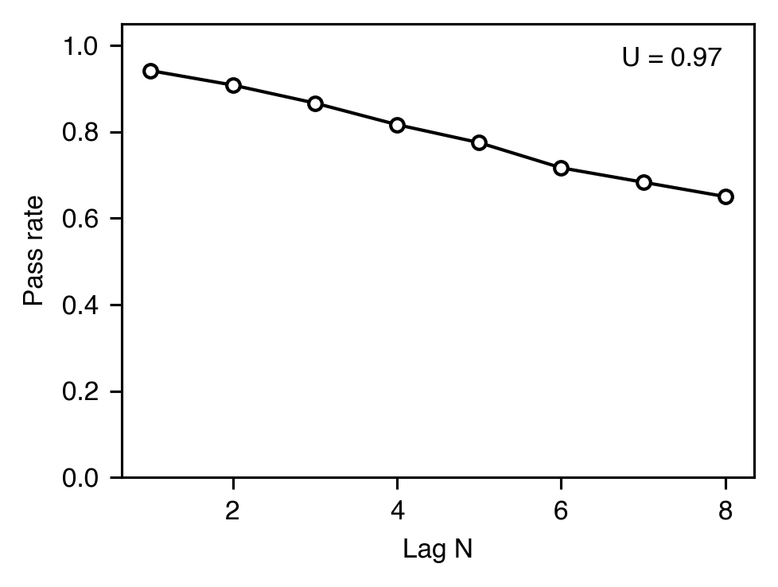
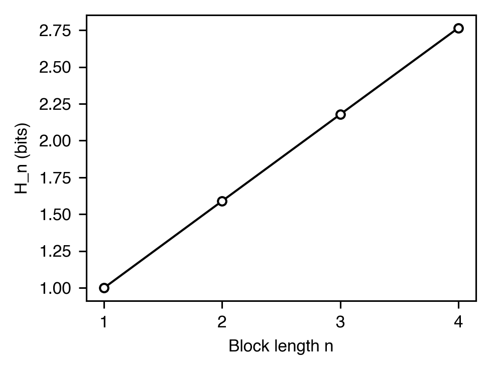

# Variability

[← Catalog index](index.md) · [日本語版](../../ja/analyses/variability.md)

Behavioral variability as an operant: how uniformly the subject
distributes responding across the space of possible sequences, and
how that distribution responds to a Lag-N reinforcement requirement.

---

### `variability` — `VariabilityMetrics` (U-value)

- **Theme** — Page & Neuringer (1985) showed that variability itself can be an operant. `U = H / log N` normalizes observed entropy to `[0, 1]`, where 1 means uniform use of all possible sequences.
- **Equation** — `H = -Σ p_i · log₂ p_i`; `U = H / log₂ N_possible`
- **Output** — `VariabilityMetrics(u_value=0.78, entropy_bits=6.25, n_sequences=120, n_unique=38, n_possible=256)`
- **Reference** — Page, S., & Neuringer, A. (1985). Variability is an operant. *J. Exp. Psychol.: ABP*, 11(3), 429-452. <https://doi.org/10.1037/0097-7403.11.3.429>

### Lag-N variability — `LagVariabilityMetrics`

- **Theme** — Under a Lag-N variability schedule, a sequence is reinforced only if it differs from each of the previous N sequences (Page & Neuringer, 1985; Neuringer, 2002). `LagVariabilityMetrics` bundles the overall U-value with two lag-specific summaries: the *Lag-N pass rate* (the fraction of trials whose sequence differs from each of the previous N — equal to the reinforcement rate under a strict Lag-N schedule) and the average count of unique sequences in trailing length-`N` windows.
- **Output** — `LagVariabilityMetrics(u_value=0.78, lag_pass_rate=0.62, mean_unique_in_window=2.4, lag=4, n_sequences=120)`
- **References** — Page, S., & Neuringer, A. (1985). Variability is an operant. *J. Exp. Psychol.: ABP*, 11(3), 429-452. <https://doi.org/10.1037/0097-7403.11.3.429> — Neuringer, A. (2002). Operant variability: Evidence, functions, and theory. *Psychonomic Bulletin & Review*, 9(4), 672-705. <https://doi.org/10.3758/BF03196324>

### N-gram block / conditional entropy — `BlockEntropy` / `ConditionalEntropy` / `MarkovOrderEstimate`

- **Theme** — Decomposes sequence dependency beyond the U-value. `compute_block_entropy(n)` is the Shannon entropy of length-`n` substrings. `compute_conditional_entropy(n)` returns `h_n = H_{n+1} - H_n`. `estimate_markov_order` uses the entropy-rate plateau as a heuristic Markov-order estimate.
- **Equations** — `H_n = -Σ p(s_n) · log₂ p(s_n)`; `h_n = H_{n+1} − H_n`
- **Output** — `BlockEntropy(order=2, entropy_bits=1.94, n_blocks=199, n_unique_blocks=4)`; `MarkovOrderEstimate(estimated_order=1, h_rates=(1.0, 0.61, 0.59, 0.59, 0.59), tolerance=0.05, converged=True)`
- **References** — Towse, J. N., & Neil, D. (1998). Analyzing human random generation behavior: A review of methods used and a computer program for describing performance. *Behav. Res. Methods Instrum. Comput.*, 30(4), 583-591. <https://doi.org/10.3758/BF03209475> — Cover, T. M., & Thomas, J. A. (2006). *Elements of information theory* (2nd ed.). Wiley.

