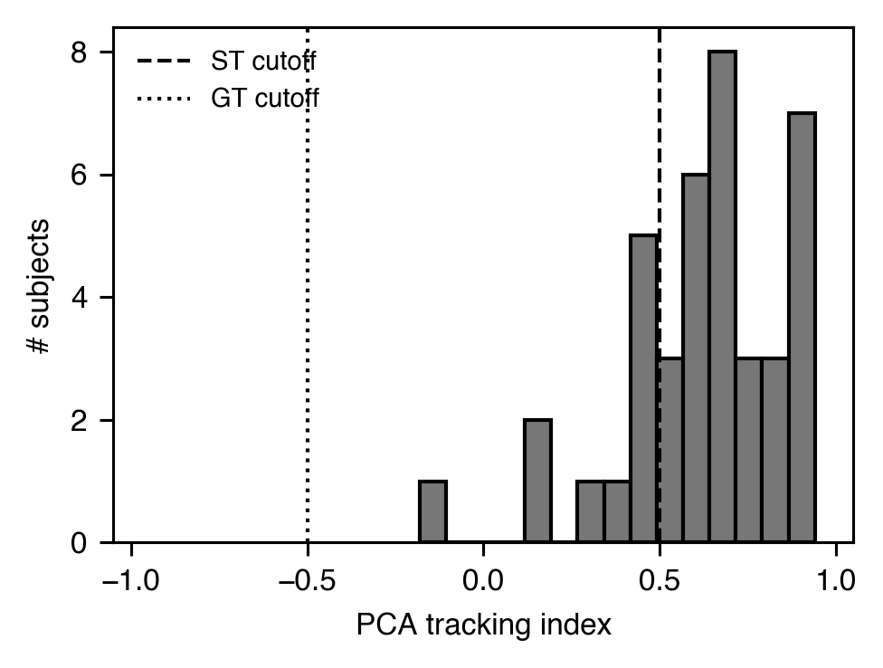
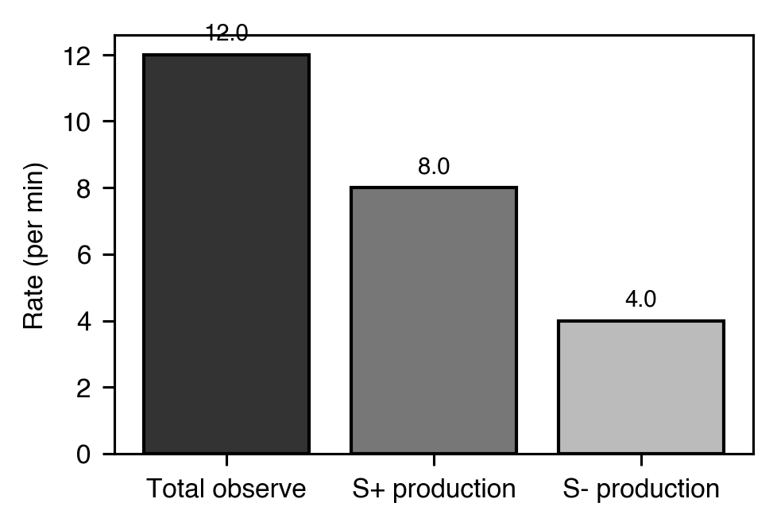
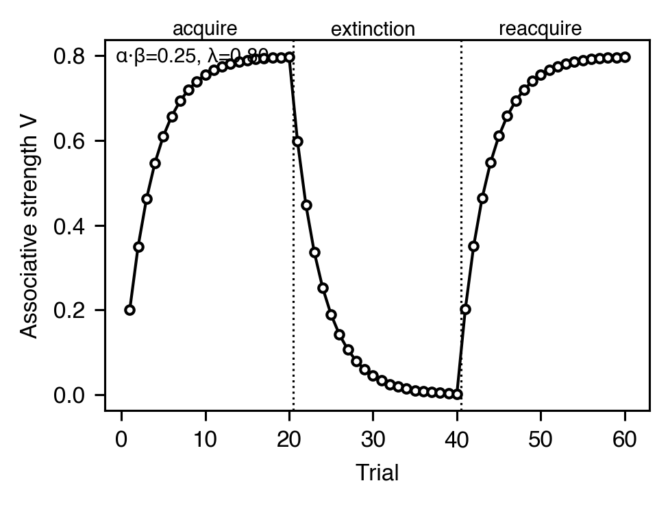

# Pavlovian

[← カタログ目次](index.md) · [English](../../en/analyses/pavlovian.md)

条件刺激関連の指標：CS と目標位置のどちらに接近するか、刺激が条件性
強化子としてどれほど強くなっているか。

---

### `tracking_index` — `TrackingIndex`

- **テーマ** — レバー CS 課題では個体が「sign-tracker」（CS レバーに接近）と「goal-tracker」（餌皿に接近）に分かれる。PCA tracking index は response-bias / latency / probability を平均し `[-1, +1]` に正規化。
- **出力** — `TrackingIndex(response_bias=0.42, latency_score=0.35, probability_score=0.28, index=0.35, classification=TrackingType.SIGN_TRACKER)`
- **引用** — Meyer, P. J., et al. (2012). Quantifying individual variation in the propensity to attribute incentive salience to reward cues. *PLoS ONE*, 7(6), e38987. <https://doi.org/10.1371/journal.pone.0038987>

### 観察反応 — `ObservingMetrics`

- **テーマ** — *observing-response* 手続き（Wyckoff, 1952）では、必須でない応答が後続スケジュール期が強化（S+）か消去（S-）かを示す刺激を呈示する。観察反応の rate を弁別刺激の条件性強化子強度の指標とする。Dinsmoor (1983) の主張通り、観察は S+ 呈示によって維持される — `s_plus_proportion ≥ 0.6` が good-news の慣例しきい値。
- **出力** — `ObservingMetrics(observing_rate_per_min=12.0, s_plus_proportion=0.67, good_news_dominance=True, observing_count=120, s_plus_productions=80, s_minus_productions=40, observing_duration_sec=600.0)`
- **引用** — Wyckoff, L. B. (1952). The role of observing responses in discrimination learning. *Psychological Review*, 59(6), 431-442. <https://doi.org/10.1037/h0053932> / Dinsmoor, J. A. (1983). Observing and conditioned reinforcement. *Behavioral and Brain Sciences*, 6(4), 693-704. <https://doi.org/10.1017/S0140525X00017969>

### 条件性強化子の強度 — `ConditionedReinforcementStrength`

- **テーマ** — 完全相関条件（S+ / S- が強化 / 消去を予測）と yoked / 無相関統制条件の間の観察 rate 比として、刺激の条件性強化子機能を定量化。`≥ 2` を「条件性強化子として獲得された」の慣例的証拠とみなす。
- **出力** — `ConditionedReinforcementStrength(strength_index=6.0, observing_rate_correlated=12.0, observing_rate_uncorrelated=2.0, is_conditioned_reinforcer=True)`
- **引用** — Dinsmoor, J. A. (1983). Observing and conditioned reinforcement. *Behavioral and Brain Sciences*, 6(4), 693-704. <https://doi.org/10.1017/S0140525X00017969>

### Rescorla-Wagner — `RescorlaWagnerParameters`

- **テーマ** — 単一 CS の試行ごとの連合強度更新: `ΔV_t = α·β·(λ_t - V_t)`。`simulate_rescorla_wagner` は与えたパラメータでトレースを生成、`fit_rescorla_wagner` は観測トレースから合成学習率 `α·β` と漸近値 `λ` を Nelder-Mead で復元する。図は獲得-消去-再獲得を示し、復元パラメータをオーバーレイ。
- **式** — `V_{t+1} = V_t + α·β·(λ_t - V_t)`
- **出力** — `RescorlaWagnerParameters(alpha_beta=0.25, lambda_=0.80, initial_v=0.0, sse=0.001, r_squared=0.999, n_trials=60)`
- **引用** — Rescorla, R. A., & Wagner, A. R. (1972). A theory of Pavlovian conditioning. In *Classical conditioning II* (pp. 64-99). Appleton-Century-Crofts.

