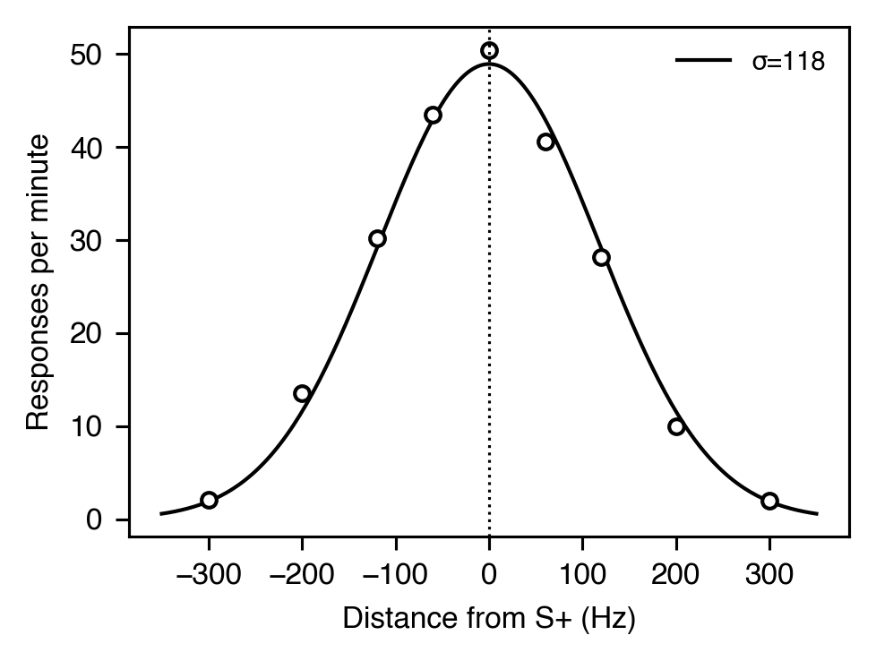

# 刺激性制御

[← カタログ目次](index.md) · [English](../../en/analyses/stimulus-control.md)

弁別刺激制御：般化勾配、S+ / S- 弁別、混合訓練後の peak shift、
信号検出理論による感度・バイアス分解。

---

### Gaussian 般化勾配 — `GaussianGradientParameters`

- **テーマ** — 弁別刺激の般化勾配はしばしば訓練刺激を中心とした対称な釣鐘型尾を持つ。Gaussian fit で幅 (`sigma`) とピーク応答を要約。
- **式** — `R(d) = R0 · exp(-d² / (2σ²))`
- **出力** — `GaussianGradientParameters(peak_response=48.3, sigma=120.0, r_squared=0.98, n=9)`
- **引用** — Guttman, N., & Kalish, H. I. (1956). *J. Exp. Psychol.*, 51(1), 79-88. <https://doi.org/10.1037/h0046219>

### Exponential 般化勾配 — `ExponentialGradientParameters`

- **テーマ** — Shepard (1987) は「普遍的」般化法則は指数 `R(d) = R0 · exp(-d / λ)` だと主張。Gaussian fit に系統的な重い裾残差が残る場合に使う。
- **出力** — `ExponentialGradientParameters(peak_response=48.3, length_scale=175.0, r_squared=0.97, n=9)`
- **引用** — Shepard, R. N. (1987). Toward a universal law of generalization for psychological science. *Science*, 237(4820), 1317-1323. <https://doi.org/10.1126/science.3629243>

### Discrimination ratio — `DiscriminationRatio`

- **テーマ** — S+ / S- 弁別の最も簡素な要約は S+ 期に応答した割合 `DR = R(S+) / [R(S+) + R(S-)]`。等価な *suppression ratio*（Annau & Kamin, 1961）は `R(S-) / [R(S+) + R(S-)]`。`DR ≥ 0.75` を「弁別成立」の慣例しきい値とする。
- **出力** — `DiscriminationRatio(discrimination_ratio=0.85, suppression_ratio=0.15, s_plus_count=170, s_minus_count=30, is_discriminated=True)`
- **引用** — Annau, Z., & Kamin, L. J. (1961). The conditioned emotional response as a function of intensity of the US. *J. Comp. Physiol. Psychol.*, 54(4), 428-432. <https://doi.org/10.1037/h0042199>

### Peak shift — `PeakShiftResult`

- **テーマ** — 混合 S+ / S- 訓練後、般化勾配の経験的ピークは S- から **離れる方向に** 移動し、しばしば S+ をも越える（Hanson, 1959）。free-peak Gaussian をフィットし、(S+ − S-) 方向に投影した符号付きシフトを報告する。
- **式** — `R(x) = R0 · exp(-(x - μ)² / (2σ²))`、`μ` を自由パラメータ化。
- **出力** — `PeakShiftResult(empirical_peak_value=560.0, fitted_peak_value=559.7, fitted_sigma=12.4, fitted_peak_response=49.8, s_plus=550.0, s_minus=540.0, shift_magnitude=9.7, shift_direction="away_from_s_minus", r_squared=0.99, n=8)`
- **引用** — Hanson, H. M. (1959). Effects of discrimination training on stimulus generalization. *J. Exp. Psychol.*, 58(5), 321-334. <https://doi.org/10.1037/h0042606>

### 信号検出 — `SignalDetectionMetrics` / `ROCCurve`

- **テーマ** — yes/no 検出課題で感度と応答バイアスが交絡している場合、信号検出理論（Green & Swets, 1966）が `d'`（感度）と `c` / `β`（バイアス）に分解する。非パラ `A'` / `B''` はバイアス耐性のある代替。`compute_roc` は複数の operating point から経験的 ROC と台形 AUC を構成する。Hautus (1995) の log-linear 補正を常に適用してceiling / floor を扱う。
- **式** — `d' = z(H) − z(F)`; `c = -0.5(z(H) + z(F))`; `β = exp(c · d')`
- **出力（sdt）** — `SignalDetectionMetrics(hit_rate=0.84, false_alarm_rate=0.16, d_prime=2.0, criterion=0.0, beta=1.0, a_prime=0.92, b_double_prime=0.0, n_signal_trials=100, n_noise_trials=100)`
- **出力（roc）** — `ROCCurve(fa_rates=[0.0, 0.01, 0.10, 0.30, 0.55, 0.90, 1.0], hit_rates=[0.0, 0.05, 0.30, 0.60, 0.85, 0.99, 1.0], auc=0.85)`
- **引用** — Green, D. M., & Swets, J. A. (1966). *Signal detection theory and psychophysics*. Wiley. / Hautus, M. J. (1995). Corrections for extreme proportions and their biasing effects on estimated values of d'. *Behav. Res. Methods Instrum. Comput.*, 27(1), 46-51. <https://doi.org/10.3758/BF03203619>
