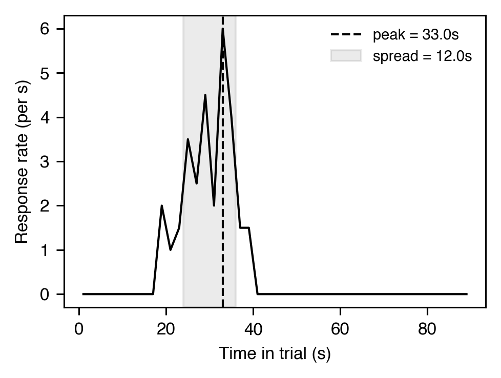

# 時間制御

[← カタログ目次](index.md) · [English](../../en/analyses/temporal.md)

応答時刻の分析：応答がスケジュールの時間構造をどう追従しているか、
セッション内でどう推移するか。

---

### `peak_procedure_binned` — `PeakTrialBinnedMetrics`

- **テーマ** — peak trial（強化子なし試行）では応答率が上昇し、期待時刻付近でピークを打ち、再び下降する — 内部時計のシグネチャ。binned rate 分析で peak time / peak rate / spread を得る。
- **出力** — `PeakTrialBinnedMetrics(peak_time=30.2, peak_rate=1.24, start_time=18.7, stop_time=42.8, spread=24.1, middle_time=30.75, n_responses=58, bin_width=1.0)`
- **引用** — Roberts, S. (1981). Isolation of an internal clock. *J. Exp. Psychol.: ABP*, 7(3), 242-268. <https://doi.org/10.1037/0097-7403.7.3.242>

### `peak_procedure_mle` — `PeakTrialMLEMetrics`（3 状態 MLE、**heavy tier**）

- **テーマ** — Church, Meck, & Gibbon (1994) は peak trial を 3 つの Poisson 状態（低・高・低）でモデル化し、2 つの switch time `(s1, s2)` を MLE 推定する。grand-average ではなく試行レベルの遷移時刻が得られる。
- **出力** — `PeakTrialMLEMetrics(start_time=20.1, stop_time=41.5, high_rate=1.82, low_rate=0.21, middle_time=30.8, spread=21.4, n_responses=58, log_likelihood=-132.7)`
- **引用** — Church, R. M., Meck, W. H., & Gibbon, J. (1994). Application of scalar timing theory to individual trials. *J. Exp. Psychol.: ABP*, 20(2), 135-155. <https://doi.org/10.1037/0097-7403.20.2.135>

### セッション内ダイナミクス — `WithinSessionDynamics`

- **テーマ** — セッション内応答率は典型的に逆 U 字を辿る（McSweeney, Roll, & Cannon, 1994）：短い warm-up 上昇、ピーク、飽和による下降。bin 軌道と rise / fall 傾きでこの軌道を要約し、動機減衰と純粋な rate 制御を分離できる。
- **出力** — `WithinSessionDynamics(rates=[0.5, 1.4, 2.1, 2.4, 2.0, 1.5, 1.0, 0.7], peak_bin=3, peak_rate=2.4, rise_slope=0.62, fall_slope=-0.34, bilinear_r_squared=0.96, n_bins=8, n_responses=240)`
- **引用** — McSweeney, F. K., Roll, J. M., & Cannon, C. B. (1994). The generality of within-session patterns of responding. *Animal Learning & Behavior*, 22(3), 252-266. <https://doi.org/10.3758/BF03209833>
