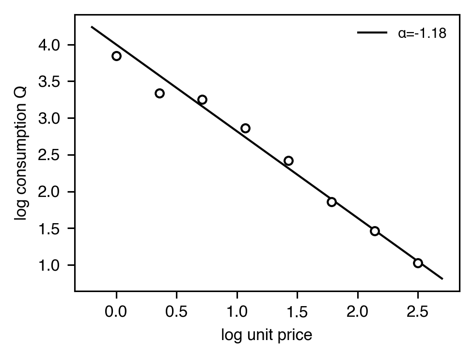
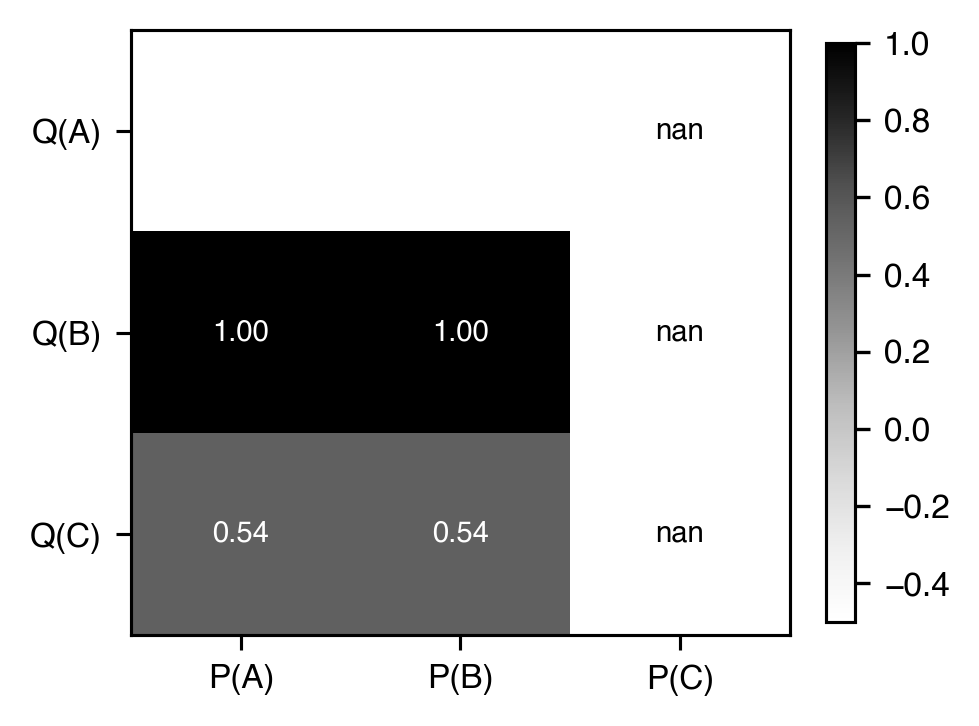
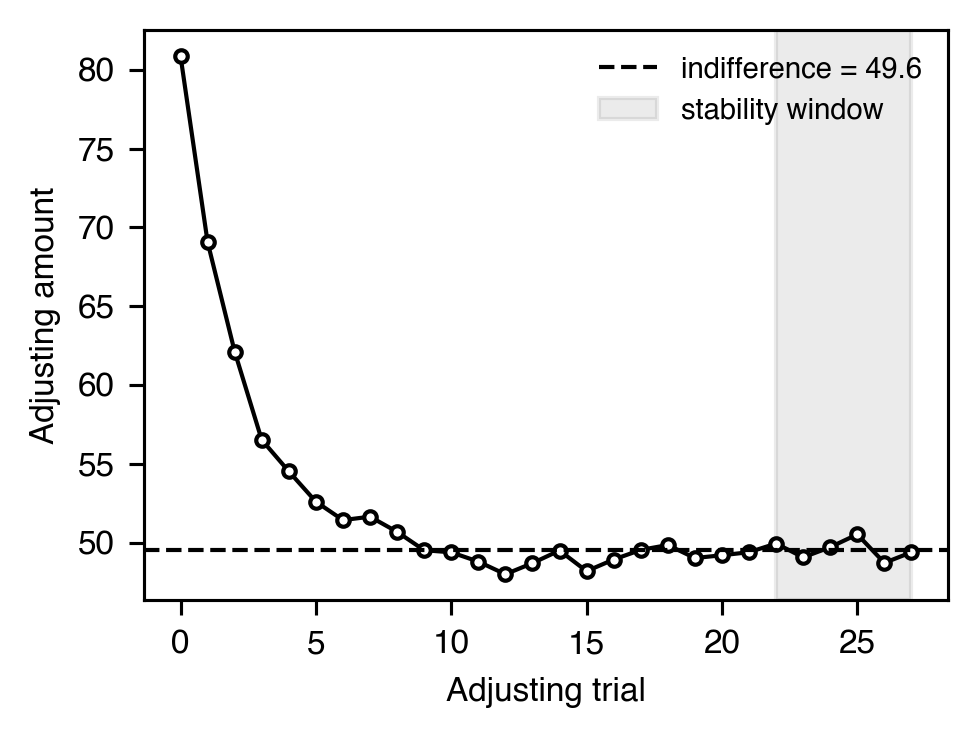

# 価値・行動経済学

[← カタログ目次](index.md) · [English](../../en/analyses/value-and-economics.md)

強化子の価値指標：被験体がどこまで応答労力を払うか、価値が遅延・価格で
どれほど急峻に割り引かれるか、2 つの選択肢の無差異点はどこか。

---

### `breakpoint` — `BreakpointResult`（Progressive Ratio）

- **テーマ** — PR スケジュールでは比率要件が漸増し、被験体が十分に長い pause を入れた時点でセッション終了とみなす。最後に完了した比率（**breakpoint**）が強化子有効性の指標。薬物自己投与・齧歯類行動経済学の標準。
- **出力** — `BreakpointResult(breakpoint_ratio=28, n_ratios_completed=12, terminal_pause_sec=312.4, threshold_sec=300.0, method="pause_threshold")`
- **引用** — Richardson, N. R., & Roberts, D. C. S. (1996). Progressive ratio schedules in drug self-administration studies in rats. *Journal of Neuroscience Methods*, 66(1), 1-11. <https://doi.org/10.1016/0165-0270(95)00153-0>

### `demand_curve` — `DemandParameters`（指数需要、**heavy tier**）

- **テーマ** — 単位価格 `P` の関数としての消費量 `Q`。Hursh & Silberberg (2008) は essential value (`1/α`) を返す 3 パラメータ指数式を提案。薬物・食物の行動経済学の標準。
- **式** — `log10 Q = log10 Q0 + k · (exp(-α · Q0 · P) - 1)`
- **出力** — `DemandParameters(q0=62.1, alpha=0.0023, k=2.9, r_squared=0.96, n=10, p_max=18.7, o_max=1162.0)`
- **引用** — Hursh, S. R., & Silberberg, A. (2008). Economic demand and essential value. *Psychological Review*, 115(1), 186-198. <https://doi.org/10.1037/0033-295X.115.1.186>

### Unit-price 弾力性 — `UnitPriceElasticity`

- **テーマ** — 指数需要の補完となる、消費量を unit price（`responses / dose`）に対して log-log 線形回帰した OLS 傾き ``α``。同じ unit price を持つ操作は同じ消費量を支持する（Hursh, 1980, 1991）。`|α| > 1` は *elastic*、`|α| < 1` は *inelastic*。
- **式** — `log Q = α · log P + c`
- **出力** — `UnitPriceElasticity(elasticity=-1.18, intercept=4.05, r_squared=0.99, n=8, is_elastic=True, is_inelastic=False)`
- **引用** — Hursh, S. R. (1980). Economic concepts for the analysis of behavior. *JEAB*, 34(2), 219-238. <https://doi.org/10.1901/jeab.1980.34-219>

### Cross-price 弾力性 — `CrossPriceElasticity`

- **テーマ** — `log Q_A` を `log P_B` に対して線形回帰した傾き — 強化子 A の消費が強化子 B の価格にどう依存するか。正なら代替財、負なら補完財、ほぼ 0 なら独立（Hursh & Roma, 2013）。
- **出力** — `CrossPriceElasticity(elasticity=0.62, intercept=2.31, r_squared=0.96, n=6, relationship="substitutes")`
- **引用** — Hursh, S. R., & Roma, P. G. (2013). Behavioral economics and empirical public policy. *JEAB*, 99(1), 98-124. <https://doi.org/10.1002/jeab.7>

### 多財 cross-elasticity 行列 — `CrossElasticityMatrix`

- **テーマ** — 単一ペアの `CrossPriceElasticity` を ``K × K`` 行列 `ε_{ij} = d log Q_i / d log P_j` に一般化。非対角は代替（正）/ 補完（負）を、対角は own-price 弾力性を表す。`compute_cross_elasticity_matrix` は各セルで log-log OLS を行い、有効ペアが 2 未満のセルは NaN を返す。
- **出力** — `CrossElasticityMatrix(goods=("A", "B", "C"), matrix=((-0.5, 1.0, 0.0), (1.0, -0.5, 0.0), (0.3, 0.0, -0.7)), n_conditions=5)`
- **引用** — Hursh, S. R., & Roma, P. G. (2013). Behavioral economics and empirical public policy. *JEAB*, 99(1), 98-124. <https://doi.org/10.1002/jeab.7>

### 遅延割引 — `HyperbolicDiscountingParameters` / `HyperboloidDiscountingParameters`

- **テーマ** — 強化子の主観的価値が遅延でどう低下するか。Mazur の双曲式が動物標準。Rachlin の hyperboloid は指数 `s` を加え、ヒトデータに見られる非線形時間知覚を取り込む。`k` が大きいほど割引が急（衝動性高）。
- **式** — Hyperbolic `V = A / (1 + k·D)` · Hyperboloid `V = A / (1 + k·D)^s`
- **出力（hyperbolic）** — `HyperbolicDiscountingParameters(k=0.031, r_squared=0.95, n=7)`
- **出力（hyperboloid）** — `HyperboloidDiscountingParameters(k=0.022, s=0.81, r_squared=0.97, n=7)`
- **引用** — Mazur, J. E. (1987). In *Quantitative analyses of behavior, Vol. 5*. / Rachlin, H. (2006). Notes on discounting. *JEAB*, 85(3), 425-435. <https://doi.org/10.1901/jeab.2006.85-05>

### Adjusting 無差異点 — `IndifferencePoint`

- **テーマ** — *adjusting-amount*（または *adjusting-delay*）手続き（Mazur, 1987）では、titration 対象の次元が被験体の即時 / 遅延選好に応じて増減する。被験体が無差異になる値に収束する。`IndifferencePoint` は trailing 安定窓の平均と安定フラグを返す。
- **出力** — `IndifferencePoint(indifference_value=49.83, range_in_window=1.5, stable=True, stable_window=6, n_trials=24)`
- **引用** — Mazur, J. E. (1987). An adjusting procedure for studying delayed reinforcement. In *Quantitative analyses of behavior, Vol. 5* (pp. 55-73). Lawrence Erlbaum.

