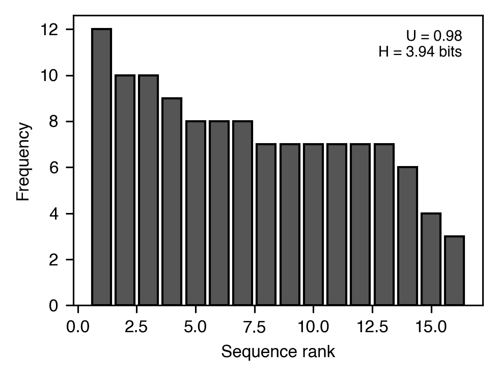

# 変動性

[← カタログ目次](index.md) · [English](../../en/analyses/variability.md)

変動性をオペラントとして扱う：被験体が可能な系列空間にどれだけ
一様に応答を分配しているか、Lag-N 強化要件への応答性。

---

### `variability` — `VariabilityMetrics`（U-value）

- **テーマ** — Page & Neuringer (1985) は変動性自体がオペラントになり得ることを示した。`U = H / log N` は観測エントロピーを `[0, 1]` に正規化し、1 はすべての可能系列を一様に使うことを意味する。
- **式** — `H = -Σ p_i · log₂ p_i`; `U = H / log₂ N_possible`
- **出力** — `VariabilityMetrics(u_value=0.78, entropy_bits=6.25, n_sequences=120, n_unique=38, n_possible=256)`
- **引用** — Page, S., & Neuringer, A. (1985). Variability is an operant. *J. Exp. Psychol.: ABP*, 11(3), 429-452. <https://doi.org/10.1037/0097-7403.11.3.429>

### Lag-N variability — `LagVariabilityMetrics`

- **テーマ** — Lag-N variability スケジュールでは現在の系列が直前 N 個と全て異なる場合にのみ強化される（Page & Neuringer, 1985; Neuringer, 2002）。`LagVariabilityMetrics` は全体 U-value に加えて 2 つの lag-specific 要約を返す：*Lag-N pass rate*（直前 N と異なる系列の割合 — 厳密 Lag-N の強化率に等しい）と、長さ `N` の trailing 窓中の平均一意系列数。
- **出力** — `LagVariabilityMetrics(u_value=0.78, lag_pass_rate=0.62, mean_unique_in_window=2.4, lag=4, n_sequences=120)`
- **引用** — Page, S., & Neuringer, A. (1985). Variability is an operant. *J. Exp. Psychol.: ABP*, 11(3), 429-452. <https://doi.org/10.1037/0097-7403.11.3.429> / Neuringer, A. (2002). Operant variability: Evidence, functions, and theory. *Psychonomic Bulletin & Review*, 9(4), 672-705. <https://doi.org/10.3758/BF03196324>
